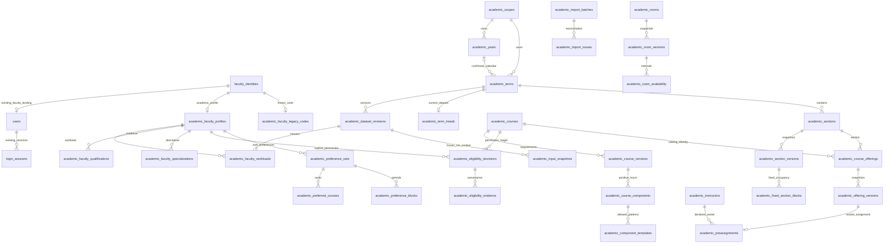
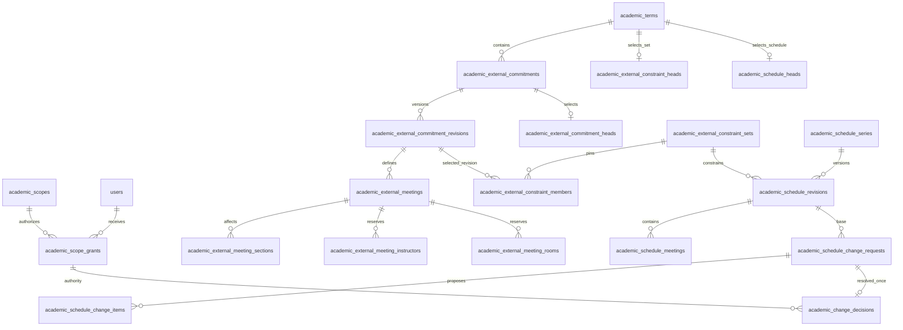

# Phase 4C.1 relational architecture and field dictionary

**2026-10-20 requirement extension:** [C14/C15](../phase-4c1-academic-data-contract.md#10-confirmed-professor-requirements-c14-and-c15) and [section 9](#9-confirmed-requirement-extensions-2026-10-20) add future external/GEC management, faculty requests and department-scoped Chair approval. These are **design candidates only**, not additions to the approved seven-table `4c_0001` migration. The original 41-table target remains a historical draft, not a migration inventory or an implemented schema. The [byte-identical original dictionary](../testing/phase-4c/design-history/2026-10-19/docs/architecture/phase-4c1-relational-schema.md) and original manifest hashes are retained; current/snapshot hashes are mapped in the [requirements-update manifest](../testing/phase-4c/phase-4c-confirmed-requirements-manifest.json).

**DRAFT / NOT IMPLEMENTED**, 2026-10-19, Asia/Manila; baseline `3167cda2bd2d86011b50ea582026a4c39accb529`. Read with the [academic contract](../phase-4c1-academic-data-contract.md). This is an entity/constraint proposal, not executable SQL or an Alembic migration. Institutional U decisions in that contract remain open. No PostgreSQL instance was queried.

## 1. Type, ownership and lifecycle conventions

- `uuid` means PostgreSQL UUID; allocate opaque IDs independently of GA RNG. Existing imported IDs are retained exactly. PK = primary key; FK = foreign key; UQ = unique constraint. `?` means nullable; all other fields are required. `text`, `varchar(n)`, `integer`, `smallint`, `boolean`, `date`, `timestamptz`, `numeric(8,2)`, `jsonb`, and `char(64)` below are proposed storage types, not runtime migrations.
- New stable administrative rows have **A**: `created_at timestamptz`, `updated_at timestamptz`, `row_version bigint > 0`, `is_active boolean`, `archived_at timestamptz?`. Archive/deactivate cannot change identity keys or delete referenced history. Existing auth tables do **not** acquire A implicitly.
- **DS** means the three required columns `dataset_id uuid`, `term_id uuid`, `scope_id uuid`, with composite FK `(dataset_id,term_id,scope_id) -> academic_dataset_revisions(id,term_id,scope_id)`. Every dataset child retains this tuple. References between versioned children also include DS; duplicated term/scope fields are constrained, not client-controlled independent facts.
- Stable scoped parents expose UQ `(id,scope_id)` (or `(faculty_id,scope_id)`); term-scoped parents also expose UQ `(id,term_id,scope_id)`. Versioned children expose UQ `(dataset_id,term_id,scope_id,<entity key>)` in addition to the PK shown. Every child reference to a DS-bearing parent includes the DS tuple, not just the parent's UUID. Use these composite keys for FKs to reject scope/term/dataset mixing in the database. No unconstrained polymorphic FK replaces these relationships.
- Validated dataset children are immutable. Draft updates require optimistic revision checks. New revisions carry provenance and source order; no implicit cascading clone or activation. Preference revisions are independent append-only aggregates; changing their head does not rewrite a validated academic dataset.
- Unless specifically stated, academic FKs use `ON DELETE RESTRICT`; deletion is unavailable through the proposed management API. A database migration owner is distinct from the runtime role; runtime privileges exclude DDL and unrestricted import/audit deletion. Final privilege grants require separate review.

## 2. Entity relationship proposal

This diagram shows the principal relationships; DS composite FKs and the child/detail tables are specified in the dictionary below.

The optional existing user binding applies only to faculty users: administrators remain unbound under the existing CHECK. The optional year relation permits an unresolved legacy term. The optional preassignment is per dataset/offering, not one global assignment across every term. Diagram multiplicity does not grant permission or imply runtime features.

## 3. Existing identity foundation: retain unchanged

| Table | Existing fields, keys and constraints |
|---|---|
| `faculty_identities` | `id uuid PK`, `display_code varchar(100) UQ`, `name varchar(200)`; imported registry identity, never rebuilt from academic profile names |
| `users` | `id uuid PK`, `username varchar(254) UQ/lowercase`, `password_hash varchar(512)`, `role varchar(20)`, `faculty_id uuid? FK faculty_identities.id UQ`, `is_active boolean`, `created_at/updated_at timestamptz`; existing role/binding CHECKs remain |
| `login_sessions` | `id uuid PK`, `token_hash varchar(64) UQ`, `user_id uuid FK users.id ON DELETE CASCADE`, `csrf_token varchar(64)`, `expires_at/created_at timestamptz`; existing user/expiry indexes remain |

Do not copy credentials or session rows into academic tables/imports/audit payloads. No change to login, cookie, CSRF, ownership, bootstrap or role behavior is proposed here.

## 4. Scope, calendar and academic dataset revisions

| Proposed table | Fields and keys | Constraints / meaning |
|---|---|---|
| `academic_scopes` | `id uuid PK`, `scope_key varchar(100) UQ`, `institution_label text`, `department_label text`, A | Initial immutable scope key is `msu-iit:ccs`; labels need no invented institution-wide tenant system |
| `academic_years` | `id uuid PK`, `scope_id uuid FK scopes`, `year_key varchar(40)`, `label varchar(100)`, `start_date date?`, `end_date date?`, `calendar_status varchar(20)`, A | UQ(scope_id,year_key); `unresolved/confirmed`; dates both NULL or both present with start <= end; confirmed requires both dates |
| `academic_terms` | `id uuid PK`, `scope_id uuid FK`, `year_id uuid? FK years`, `term_key varchar(80)`, `identity_scope varchar(160) UQ`, `label varchar(100)`, `kind varchar(24)`, `ordinal smallint?`, `start_date/end_date date?`, `timezone varchar(64)`, `calendar_status varchar(20)`, `lifecycle varchar(20)`, A | UQ(scope_id,term_key), UQ(year_id,ordinal) when year is known; `legacy_unknown/first/second/midyear/other`; lifecycle draft/open/locked/archived. Confirmed requires year, ordinal and contained dates. Composite FK enforces same-scope year; containment needs service + DB enforcement |
| `academic_dataset_revisions` | `id uuid PK`, `term_id/scope_id uuid FK terms`, `revision integer`, `parent_id uuid? self FK`, `state varchar(20)`, `policy_version varchar(64)`, `import_batch_id uuid? FK import_batches`, `source_manifest jsonb`, `source_order jsonb`, `content_sha256 char(64)?`, `created_by uuid? FK users`, `created_at timestamptz`, `validated_at timestamptz?` | UQ(term_id,revision); draft/validated/retired; parent same term/scope; revision > 0; validated requires hash, validation time and complete reconciliation; immutable payload afterward. `source_order` contains stable keys/ordinals, no arbitrary SQL ordering |
| `academic_term_heads` | `term_id uuid PK FK terms`, `scope_id uuid`, `dataset_id uuid`, `row_version bigint`, `updated_by uuid? FK users`, `updated_at timestamptz` | Composite FK(dataset_id,term_id,scope_id) to revisions; select validated dataset only. Term-row/head lock and CAS serialize activation; never interpret one head as a global current term |

Term boundaries use inclusive local dates; weekly meeting intervals use half-open `[start,end)` minutes. Disallow end-before-start and partial date pairs. Whether confirmed terms may overlap is U01: do not invent an overlap exclusion across every term until confirmed. Calendar status and lifecycle must not contradict (an unresolved legacy container cannot be activated as a confirmed new-term production source).

## 5. Faculty, instructor identity and academic evidence

| Proposed table | Fields and keys | Constraints / meaning |
|---|---|---|
| `academic_faculty_profiles` | `faculty_id uuid PK FK faculty_identities.id`, `scope_id uuid FK scopes`, `employment_category varchar(80)?`, `academic_rank varchar(80)?`, `profile_status varchar(24)`, A | Unknown fields stay NULL. No inferred rank from numeric legacy priority. UQ(faculty_id,scope_id); current identity name/label remains on existing table; old snapshots retain their original descriptive context |
| `academic_faculty_legacy_codes` | `faculty_id uuid PK FK profiles`, `legacy_code integer UQ`, `allocated_at timestamptz`, `provenance_batch_id uuid? FK import_batches` | Code >= 0; preserve all current codes globally for the frozen CCS bridge; no reuse after deactivation. Concurrent allocation needs an allocator lock or sequence initialized above reviewed max, not unlocked MAX+1 |
| `academic_faculty_aliases` | `id uuid PK`, `faculty_id/scope_id uuid FK profiles`, `normalized_alias varchar(200)`, `source_kind varchar(40)`, `import_batch_id uuid? FK`, `created_at timestamptz` | UQ(scope_id,normalized_alias); only verified source aliases. An alias collision requires review, not a human-name uniqueness assumption or automatic faculty merge |
| `academic_instructors` | `id uuid PK`, `scope_id uuid FK`, `kind varchar(24)`, `faculty_id uuid? FK profiles UQ`, `legacy_external_key varchar(200)?`, `display_name varchar(200)`, A | Internal: kind optimization_faculty, faculty_id required and id=faculty_id, external key NULL. External: kind preassigned_external, faculty_id NULL, legacy key required. UQ(scope_id,legacy_external_key); preserve existing external UUID/key. Neither external registration nor active status creates an authenticated faculty account |
| `academic_faculty_qualifications` | `id uuid PK`, `faculty_id/scope_id uuid FK profiles`, `qualification_kind varchar(40)`, `label text`, `issuer text?`, `awarded_on date?`, `verification_status varchar(24)`, `supersedes_id uuid? self FK`, `source_reference text?`, `import_batch_id uuid? FK`, `recorded_by uuid? FK users`, `recorded_at timestamptz` | Append-only facts/corrections; pending/verified/withdrawn status; issuer/award/rank unknown unless supplied. UQ(supersedes_id) where present, same-faculty composite self FK and acyclic forward history; concurrent corrections conflict rather than creating two successors. Effective view selects the latest chain leaf; no public certificate/document upload or automatic eligibility grant. Private source references must not contain credentials |
| `academic_specializations` | `id uuid PK`, `scope_id uuid FK`, `code varchar(100)`, `label varchar(200)`, A | UQ(scope_id,code); taxonomy approval required; normalize matching without losing imported labels |
| `academic_faculty_specializations` | DS, `faculty_id uuid FK profiles`, `specialization_id uuid FK specializations`, `position integer`, `source_reference text?` | PK(dataset_id,faculty_id,specialization_id); UQ(dataset_id,faculty_id,position); position >= 0; both parents same scope; order round-trips, descriptive only |
| `academic_eligibility_decisions` | `id uuid PK`, DS, `faculty_id uuid FK workloads`, `course_id uuid FK courses`, `decision varchar(24)`, `decided_by uuid? FK users`, `decided_at timestamptz?` | UQ(dataset_id,faculty_id,course_id); eligible/ineligible only after reviewed normalization; absence grants nothing; composite faculty FK selects the same dataset workload row, while course FK selects the same-scope stable catalog identity, including currently unoffered courses. Preserve all legacy eligibility-set members; an eligibility row does not create a schedulable course version or offering. Only normal optimization faculty, never external account inference |
| `academic_eligibility_evidence` | `id uuid PK`, `decision_id uuid FK decisions`, `source_row_ordinal integer`, `raw_status text`, `basis text?`, `source_reference text?`, `notes text?`, `import_batch_id uuid? FK` | UQ(decision_id,source_row_ordinal); preserve multiple source records; importer must not invent precedence for conflict or drop unknown statuses. Evidence is administrator-only where it contains private faculty details |
| `academic_faculty_workloads` | DS, `faculty_id uuid FK profiles`, `construction_order integer`, `construction_priority integer`, `admin_units/research_units/extension_units integer`, `source_teaching_units integer?`, `total_target_units integer`, `hard_ceiling_units integer`, `warning_threshold_units integer`, `input_provenance varchar(24)`, `included_in_pool boolean` | PK(dataset_id,faculty_id); UQ(dataset_id,construction_order); nonnegative release inputs, positive priority/order validation. Legacy profile 24/40/30; source Teaching Load not substituted for derived target. `verified/legacy_default/unresolved`; missing data blocks institutional confirmation unless explicitly approved. Effective teaching target is derived, not an independently editable column |

Qualification rows are not currently available from the source CSV as degree records; leave this relation empty unless genuine approved data is supplied. Academic profile deactivation and `users.is_active` are separate operations with separate policy/permissions. Preserve referenced identities indefinitely until retention rules explicitly authorize a non-destructive archival alternative.

## 6. Catalog, components, offerings and fixed input construction

| Proposed table | Fields and keys | Constraints / meaning |
|---|---|---|
| `academic_courses` | `id uuid PK`, `scope_id uuid FK`, `identity_code varchar(64)`, `catalog_status varchar(24)`, A | UQ(scope_id,identity_code); nonempty normalized current code, immutable identity key. Preserve existing course UUIDs. `descriptor_only/verified` distinguishes identities from full schedulable definitions. Import reviewed additional course keys from domain/eligibility sources without inventing units/components/offerings. New aliases do not recompute IDs |
| `academic_course_aliases` | `id uuid PK`, `course_id/scope_id uuid FK courses`, `alias varchar(64)`, `created_at timestamptz`, `source_reference text?` | UQ(scope_id,alias); alias/canonical-code collisions across courses rejected by import/service plus a reviewed DB enforcement strategy |
| `academic_domains` | `id uuid PK`, `scope_id uuid FK`, `code varchar(100)`, `label varchar(200)`, A | UQ(scope_id,code); descriptive course domain, distinct from faculty specialization/permission |
| `academic_course_versions` | DS, `course_id uuid FK courses`, `title text`, `credit_units numeric(8,2)`, `lecture_weekly_minutes integer`, `lab_weekly_minutes integer`, `year_level smallint`, `metadata_status varchar(24)`, `construction_order integer` | PK(dataset_id,course_id); UQ(dataset_id,construction_order); units >= 0; minutes >= 0; year 1..4 for current adapter; supported/unsupported; at least one positive component for schedulable courses. Domain-only draft shells remain in import staging until requirements verified; no guessed zero defaults |
| `academic_course_domains` | DS, `course_id uuid FK courses`, `domain_id uuid FK domains`, `position integer`, `is_primary boolean` | PK(dataset_id,course_id,domain_id); UQ(dataset_id,course_id,position); at most one primary via partial UQ; preserve source order and distinctness. Same-scope catalog FK permits descriptor-only/unoffered courses, retaining the 37 domain rows outside the offered catalog without fabricated course requirements |
| `academic_course_components` | DS, `course_id uuid FK course_versions`, `component varchar(16)`, `weekly_minutes integer`, `required_room_type varchar(16)`, `metadata_status varchar(24)` | PK(dataset_id,course_id,component); Lecture/Laboratory; minutes > 0 and equal corresponding course-version field; required type matches component in current adapter. No zero-hour rows |
| `academic_component_templates` | `id uuid PK`, DS, `course_id/component FK course_components`, `source_order integer`, `meetings_per_week smallint`, `duration_minutes integer`, `days jsonb`, `start_minute integer`, `continuous boolean` | UQ(dataset_id,course_id,component,source_order); one row represents one actual template: same start/duration over its ordered distinct day list. Check positive duration/count; validate JSON shape/day codes, count, `count*duration=weekly_minutes`, bounds and exact authoritative template membership. No generated day/time combinations. Unsupported component has no active templates |
| `academic_sections` | `id uuid PK`, `term_id/scope_id uuid FK terms`, `identity_code varchar(40)`, A | UQ(term_id,identity_code); preserve prototype UUIDs; new term has new identity; no reuse after archive |
| `academic_section_versions` | DS, `section_id uuid FK sections`, `year_level smallint`, `program_code varchar(40)?`, `verified_enrollment integer?`, `enrollment_status varchar(24)`, `legacy_synthetic_student_count integer?`, `construction_order integer` | PK(dataset_id,section_id); section term/scope matches DS; year 1..4 initially; enrollment NULL unless verified, then >= 0. Legacy synthetic count 40 is separately labelled, not a real headcount. UQ(dataset_id,construction_order) |
| `academic_course_offerings` | `id uuid PK`, `term_id/scope_id uuid FK terms`, `course_id uuid FK courses`, `section_id uuid FK sections`, `identity_key varchar(160)`, A | UQ(term_id,course_id,section_id), UQ(term_id,identity_key); section has same term/scope; code::section identity key remains immutable for legacy records. Offerings for different terms never share IDs |
| `academic_offering_versions` | DS, `offering_id uuid FK offerings`, `course_id uuid FK course_versions`, `section_id uuid FK section_versions`, `assignment_type varchar(24)`, `construction_order integer` | PK(dataset_id,offering_id); UQ(dataset_id,construction_order). Composite FK to offering identity enforces matching course/section/term/scope, not just independently valid IDs. ga_managed/preassigned_external; construction exactly matches reviewed track rules |
| `academic_rooms` | `id uuid PK`, `scope_id uuid FK`, `identity_key varchar(100)`, A | UQ(scope_id,identity_key); deterministic reviewed name reconciliation, never collapse distinct real rooms based on loose normalization alone |
| `academic_room_versions` | DS, `room_id uuid FK rooms`, `legacy_name varchar(100)`, `display_name varchar(100)`, `room_type varchar(16)`, `capacity integer?`, `capacity_status varchar(24)`, `availability_basis varchar(40)`, `construction_order integer` | PK(dataset_id,room_id); UQ(dataset_id,construction_order); Lecture/Laboratory only initially; capacity NULL for unknown, > 0 for verified. Legacy imported grid is an assumption, not verified building availability |
| `academic_room_availability` | `id uuid PK`, DS, `room_id uuid FK room_versions`, `day varchar(2)`, `start_minute/end_minute integer`, `availability varchar(16)`, `source_reference text?` | UQ(dataset_id,room_id,day,start_minute,end_minute,availability); available/unavailable; ordered bounded half-open intervals. Reject contradictory overlaps in validated datasets; no hidden precedence. Existing 30-minute grid must round-trip before activation |
| `academic_fixed_section_blocks` | `id uuid PK`, DS, `section_id uuid FK section_versions`, `course_id uuid? FK course_versions`, `external_course_label text?`, `day varchar(2)`, `start_minute/end_minute integer`, `source_row_ordinal integer`, `source_reference text` | At least course FK or original external course label; current fixed grid uses 30-minute multiples and supported day bounds. Keep source row/day identity to detect duplicates; preserve semantically overlapping source declarations as provenance, do not fabricate assignments. Invalid/partial rows stay staged, not silently applied |
| `academic_preassignments` | DS, `offering_id uuid FK offering_versions`, `instructor_id uuid FK instructors`, `room_id uuid FK room_versions`, `source_reference text` | PK(dataset_id,offering_id); external declaration only under current compatibility profile; offering assignment_type must agree; locked room alias/type matches current validators. It declares owner/room, not a preselected meeting time or a new normal-faculty code |

Same-day adjacency is allowed: `[450,570)` and `[570,690)` do not overlap. A minimum common legacy grid of 30-minute atoms does not mean arbitrary longer subject templates are allowed. Faculty, room and section constructors currently produce grids from 07:30 through 22:00. The section docstring still mentions 20:00, but its actual `end_minutes` is 22:00; use executable constructor behavior and authoritative template membership, not stale descriptions. Preserving a grid does not expand the separate allowed subject templates.

## 7. Preference revisions and reproducible input context

| Proposed table | Fields and keys | Constraints / meaning |
|---|---|---|
| `academic_preference_sets` | `id uuid PK`, DS, `faculty_id uuid FK workloads`, `revision integer`, `supersedes_id uuid? self FK`, `record_state varchar(24)`, `validation_state varchar(24)`, `faculty_priority integer?`, `subject_importance/day_importance/time_importance/gap_importance/lecture_lab_importance smallint`, `use_subject_preference/use_day_preference/use_time_preference/use_gap_preference/use_lecture_lab_preference boolean`, `preferred_start_minute/preferred_end_minute integer?`, `gap_preference varchar(24)`, `lecture_lab_preference varchar(24)`, `raw_import_payload jsonb?`, `field_presence jsonb`, `created_by uuid? FK users`, `created_at timestamptz`, `import_batch_id uuid? FK` | UQ(dataset_id,faculty_id,revision), UQ(id,dataset_id,term_id,scope_id,faculty_id) for owner-constrained child/head FKs; same-faculty/dataset supersession; revision > 0. Missing/imported/explicit/reset states distinguish no row from choices; validation legacy_unverified/valid/rejected. Priority >= 1 when explicitly present; missing priority retains legacy fallback. Importance 0..5, exact existing style enums, paired times; preserve zero/false. Raw payload/field_presence are private import/compatibility data, never API mass-assigned or a way to bypass validation |
| `academic_preference_heads` | DS, `faculty_id uuid FK workloads`, `preference_id uuid FK preference_sets`, `row_version bigint`, `updated_at timestamptz`, `updated_by uuid? FK users` | PK(dataset_id,faculty_id); composite FK ensures selected set belongs to same faculty/dataset/term/scope. Concurrent writes CAS row_version; validated academic data can stay immutable while preference head advances within allowed collection window |
| `academic_preferred_courses` | `preference_id uuid FK preference_sets`, DS, `course_id uuid FK course_versions`, `rank integer` | PK(preference_id,course_id); UQ(preference_id,rank); rank > 0 and contiguous on valid writes; preference parent DS must match. New writes require explicit eligibility plus a GA-managed offering for this dataset |
| `academic_preferred_days` | `preference_id uuid FK preference_sets`, `day varchar(2)`, `position integer` | PK(preference_id,day); UQ(preference_id,position); supported days M/T/W/TH/F/S, preserve input ordering |
| `academic_preference_blocks` | `preference_id uuid FK preference_sets`, DS, `block_key varchar(200)`, `position integer`, `kind varchar(16)`, `day varchar(2)`, `start_minute/end_minute integer`, `course_id uuid? FK preferred_courses`, `component varchar(16)? FK course_components`, `legacy_subject_title text?` | PK(preference_id,block_key); UQ(preference_id,position); preserve opaque client IDs. General has NULL course/component/title; subject requires ranked course and matching component in same DS. Bounds 450 <= start < end <= 1320; no blanket 30-minute restriction on general periods. Subject groups must match full component pattern. FK(preference_id,course_id) references ranked course and composite DS/component FK references authoritative requirements |
| `academic_input_snapshots` | `id uuid PK`, DS, `schema_version varchar(40)`, `created_at timestamptz`, `created_by uuid? FK users`, `dataset_sha256 char(64)`, `preference_revisions jsonb`, `raw_ga_settings jsonb`, `effective_ga_settings jsonb`, `construction_policy jsonb`, `canonical_payload jsonb`, `content_sha256 char(64)`, `legacy_input_fingerprint char(64)?`, `legacy_engine_fingerprint char(64)?` | Immutable private snapshot; relational preference links below enforce identity/DS, and the JSON manifest is a derived reproducibility export. Includes observed absence, flags/order, effective defaults and descriptive profile context used by that snapshot. Arrays/maps have pinned schema and canonicalization version. Store source order/legacy construction policy; new hash is not interchangeable with legacy fingerprint. No credentials/session data or chromosome/RNG/checkpoint conversion. Capture under consistent read transaction |
| `academic_snapshot_preferences` | `snapshot_id uuid FK input_snapshots`, DS, `faculty_id uuid FK workloads`, `preference_id uuid? FK preference_sets`, `presence varchar(16)` | PK(snapshot_id,faculty_id); composite FKs constrain snapshot and faculty to DS, and a present preference to DS plus the same faculty. `present/missing/reset` records explicit absence; preference ID required for present and NULL for missing; reset references a reset revision. Snapshot service must include every captured normal faculty once, including missing preferences. JSON preference manifest must exactly mirror these links |

Input snapshot/run integration is a later activation gate, not permission to rewrite `FrozenInputs`, fingerprints or checkpoints. Preference `missing/reset` export omits a dashboard record rather than materializing an explicit neutral record; a present imported record uses its preserved field-presence map. This preserves the scorer's distinct legacy-priority fallback. Private raw import payload is never accepted directly from an ordinary faculty client. Academic profile changes use revision-checked audit diffs; snapshots retain the descriptive values they actually used instead of joining current names/rank into historical results.

Style CHECK values are exactly `Compact/Scattered/No Preference` for gap style and `Same Day/Different Day/No Preference` for lecture/lab style. Flags and importance remain independent: disabling a flag does not erase the corresponding saved value. Numeric minute storage is an internal representation; legacy API export retains HH:MM strings and the original ordered day/block/rank semantics.

## 8. Import, audit, indexes and enforcement

| Proposed table | Fields and keys | Constraints / meaning |
|---|---|---|
| `academic_import_batches` | `id uuid PK`, `scope_id uuid FK scopes`, `term_id uuid? FK terms`, `state varchar(24)`, `parser_version varchar(64)`, `source_manifest jsonb`, `decision_manifest jsonb`, `summary jsonb`, `created_by uuid? FK users`, `created_at timestamptz`, `completed_at timestamptz?`, `reviewed_source_sha256 char(64)` | draft/validated/applied/rejected; no automatic writes. Source hashes, row counts and private reconciliation reference, never DB URLs/passwords. Idempotent apply requires UQ(scope_id,term_id,reviewed_source_sha256,parser_version) for applied batches, with explicit handling of NULL term during dry run; no blindly repeated seed |
| `academic_import_issues` | `id uuid PK`, `batch_id uuid FK batches`, `source_key varchar(160)`, `row_ordinal integer?`, `row_digest char(64)?`, `code varchar(80)`, `severity varchar(16)`, `sanitized_message text`, `resolution varchar(24)`, `reviewed_by uuid? FK users`, `reviewed_at timestamptz?` | Error/warning/info; open/accepted_exclusion/corrected_source/resolved. No raw records in public logs/repository. If private raw quarantine is needed, use separately restricted storage with retention approval, not this public message field |
| `academic_change_events` | `id uuid PK`, `scope_id uuid FK`, `term_id uuid? FK`, `actor_user_id uuid? FK users ON DELETE SET NULL`, `actor_reference uuid?`, `operation varchar(80)`, `entity_kind varchar(80)`, `entity_id uuid`, `before_revision/after_revision bigint?`, `request_id uuid`, `safe_diff jsonb`, `occurred_at timestamptz` | Append-only audit, administrator-only. `entity_kind/id` is an audit locator, not a substitute for domain FKs; retain actor UUID reference if account later removed. Allowlist academic fields; never password/session/token/connection information. Imported SYSTEM action may have no actor; application actions require one |

Index every child FK and main access path (PostgreSQL does not automatically index referencing FKs): `(term_id,revision)`, `(dataset_id,faculty_id)`, `(dataset_id,course_id)`, `(dataset_id,section_id)`, `(dataset_id,room_id,day,start_minute)`, `(scope_id,is_active)` where needed, `(batch_id,resolution)`, `(scope_id,term_id,occurred_at)` for audit. PK/UQ indexes should not be duplicated. Prefer targeted indexes after actual query plans; no blanket JSONB GIN or speculative partitioning requirement. Validate all proposed composite FKs through real PostgreSQL tests before claiming enforcement.

| Invariant | Database responsibility proposed | Service/import responsibility proposed |
|---|---|---|
| Nonempty stable keys, UUID/code uniqueness, positive ranks/valid scalar ranges | PK/UQ/NOT NULL/CHECK | Stable normalization and reject conflicting source identity |
| Same scope/term/dataset and parent course/section | Explicit composite FKs/UQs, RESTRICT deletes | Authorize requested scope and immutable identity mapping |
| Correct term date containment; immutable validated children | Reviewed constraint trigger or equivalent enforced mutation API/privilege design, tested against direct runtime-role SQL | Validate before commit; no application-only claim of DB enforcement |
| Exact template/block grouping, course-component minute agreement, publication state and availability contradiction checks | Cross-row constraint triggers where practical; no unsupported CHECK subqueries | Full aggregate validation in transaction and PostgreSQL negative/concurrency tests |
| Head revision selection, one-time import and code allocation | CAS update, unique keys, row/advisory locks under bounded transactions | Safe retry only for explicitly idempotent operations; no blind replay of writes |
| Preference ownership, administrator-only priority and locked terms | Restricted runtime privileges; RLS only if separately designed/tested | Existing server principal/CSRF guards plus scope/term/field rules; no asserted current RLS |
| Snapshot settings/schema and private raw import semantics | JSONB shape/version checks plus relational snapshot-preference links when implemented | Pinned schemas, presence/order preservation, whitelist serialization and private access |

Physical index names, a future migration revision ID, trigger implementation, enum representation and runtime privilege grants must be reviewed in 4C.2. This proposal uses constrained text labels instead of prematurely creating PostgreSQL ENUM types. No schema creation, SQL execution, record import or new runtime enforcement was performed in 4C.1.

## 9. Confirmed requirement extensions: 2026-10-20

This section proposes eighteen logical relations for later review. It is **not an approved eighteen-table migration**, a new combined table-count commitment, or a modification of `4c_0001`. Reconcile the full target/dependency closure before each future migration. Read the [workflow design](../phase-4c-confirmed-scheduling-workflows.md) for states, APIs, resource coverage, permissions, transaction boundaries and acceptance criteria.

### Context and integrity conventions

Each row below has `id uuid PK` unless a composite PK is stated. **CTX** means required `term_id uuid`, `scope_id uuid`, with composite FK to the existing proposed term/scope key. Scope denotes the owning department, not the supplying college. Revisions/meetings expose the necessary `(id,term_id,scope_id)` and parent-inclusive UQs for constrained child FKs. References carry CTX plus parent/series identity wherever required to reject cross-term, cross-department or cross-parent mixing. `?` means nullable. Timestamps are `timestamptz`; FK deletion is RESTRICT; no cascading removal of histories. All FK/access paths receive targeted indexes without duplicating PK/UQ indexes.

For confirmed external and accepted schedule payloads, immutability and complete aggregate validation need database guards plus transactional services, with PostgreSQL negative/concurrency tests. Positive `row_version bigint` and an expected-revision predicate protect mutable draft/head/workflow records. Permission/time validity and aggregate invariants are not claimed to be implementable using scalar CHECKs alone. JSON audit/validation fields do not replace relational FKs.

| Future relation | Proposed fields and relationships | Principal constraints / dependency |
|---|---|---|
| `academic_scope_grants` | `user_id uuid FK users`, `scope_id uuid FK scopes`, `capability varchar(64)`, `valid_from/valid_until?`, `revoked_at?`, `granted_by uuid FK users`, `created_at`, `row_version` | Allowlisted capabilities; valid interval; no duplicate active equivalent grant; reviewed appointment/revocation authority. No new `users.role` value. Chair approval capability is department-scoped and checked at decision time; grant rows are retained after expiry/revocation. |
| `academic_external_commitments` | CTX, `external_key varchar(160)`, `created_by uuid FK users`, `created_at` | Unique `(term_id,scope_id,external_key)`; stable record identity across replacements; not required to be a CCS catalog offering. |
| `academic_external_commitment_revisions` | CTX, `commitment_id uuid FK commitments`, `revision integer`, `supersedes_id uuid? self FK`, `operation varchar(16)`, `state varchar(24)`, `provider_unit text`, `provider_reference text?`, `provider_confirmed boolean?`, `source_kind varchar(16)`, `source_sha256 char(64)?`, `import_batch_id uuid? FK academic_import_batches`, `reason text?`, `created_by/confirmed_by? uuid FK users`, timestamps, `row_version`, `content_sha256 char(64)?` | Unique `(commitment_id,revision)`; same-parent CTX supersession without cycles; replace/withdraw operation; draft/tentative/in_review/confirmed/rejected. Confirmation requires provenance, validation and confirmer/hash; immutable confirmed payload. Manual sources have no invented hash; CSV/XLSX require a source hash and private source reference. Provider confirmation does not itself activate a system constraint. |
| `academic_external_meetings` | CTX, `revision_id uuid FK external revisions`, `meeting_key varchar(160)`, `course_label text`, `course_id uuid? FK academic_courses`, `day varchar(2)`, `start_minute/end_minute integer`, `effective_start/end date`, per-resource resolution status, `source_row_ordinal integer?` | Unique `(revision_id,meeting_key)`; ordered half-open minute bounds and contained dates; supported day/grid before activation. External labels need no fabricated course version. A withdrawn revision has no active meetings; replacement must be complete. |
| `academic_external_meeting_sections` | CTX, `meeting_id uuid FK meetings`, `section_id uuid FK academic_sections`; PK(meeting_id,section_id) | Same-term/scope section; each affected section explicitly linked; multi-section commitments use one meeting identity with several links, not duplicate resource bookings. |
| `academic_external_meeting_instructors` | CTX, `meeting_id uuid FK meetings`, `instructor_id uuid FK academic_instructors`; PK(meeting_id,instructor_id) | Canonical internal/external instructor identities, never name-only joins; future instructor registry dependency. Shared faculty identity must reconcile across departments before claiming cross-department protection. |
| `academic_external_meeting_rooms` | CTX, `meeting_id uuid FK meetings`, `room_id uuid FK academic_rooms`; PK(meeting_id,room_id) | Canonical room identity and verified aliases; future room registry/shared-resource mapping dependency. A foreign room label is not automatically a CCS room or evidence of non-overlap. |
| `academic_external_commitment_heads` | `commitment_id uuid PK FK commitments`, CTX, `confirmed_revision_id uuid? FK external revisions`, `row_version`, `updated_by uuid FK users`, `updated_at` | Composite FK ensures selected revision belongs to this commitment/CTX; confirmed replacement or confirmed withdrawal only. Drafts cannot replace this head. |
| `academic_external_constraint_sets` | CTX, `revision integer`, `policy_version varchar(64)`, `content_sha256 char(64)`, `created_by uuid FK users`, `created_at` | Unique `(term_id,scope_id,revision)`; immutable complete confirmed-set snapshot; hash covers ordered members, resource mappings, date interpretation and validation policy. |
| `academic_external_constraint_members` | CTX, `set_id uuid FK constraint sets`, `commitment_id uuid FK commitments`, `revision_id uuid FK external revisions`; PK(set_id,commitment_id) | One selected confirmed revision per commitment/set; all parents share CTX and parent identity. Keep withdrawal revision references as provenance; those contribute no active intervals. |
| `academic_external_constraint_heads` | `term_id/scope_id` composite PK/FK terms, `set_id uuid FK constraint sets`, `row_version`, `updated_by uuid FK users`, `updated_at` | Selected set must match CTX. Confirmation and schedule publication/approval share a reviewed locking protocol; no unguarded independent head switches. |
| `academic_schedule_series` | CTX, `series_key varchar(160)`, `source_run_reference text?`, `source_artifact_sha256 char(64)?`, `created_by uuid FK users`, `created_at` | Unique scoped term/series key; retains original GA proposal provenance outside old files. Legacy artifacts are not auto-imported, assigned a guessed term or rewritten. |
| `academic_schedule_revisions` | CTX, `series_id uuid FK series`, `revision integer`, `parent_id uuid? self FK`, `root_ga_revision_id uuid self FK`, `origin varchar(24)`, `input_snapshot_id uuid FK academic_input_snapshots`, `constraint_set_id uuid FK external sets`, `validator_version varchar(64)`, `content_sha256 char(64)`, `created_by uuid FK users`, `created_at` | Unique `(series_id,revision)`; immutable full meeting payload; same-series/CTX parent/root; root is original GA proposal and remains unchanged. ga_proposal/chair_adjustment origins. Root has self root FK; adjusted child points to same root and immediate base parent. No mutation of serialized chromosomes or checkpoints. |
| `academic_schedule_meetings` | CTX, `series_id/revision_id uuid FK schedule revisions`, `root_meeting_id uuid self FK`, `offering_id uuid FK academic_course_offerings`, `component varchar(16)`, `occurrence_ordinal integer`, `day varchar(2)`, minute bounds, date bounds, `instructor_id uuid FK academic_instructors`, `room_id uuid FK academic_rooms` | Unique `(revision_id,root_meeting_id)` and appropriate offering/component/occurrence key; root meeting self-reference at baseline and same-series lineage thereafter. Complete component groups and required hours must validate. An offering's section is derived through its FK. External meetings remain separately pinned, not editable duplicate GA rows. |
| `academic_schedule_heads` | `term_id/scope_id` composite PK/FK terms, `series_id/revision_id uuid FK schedule revisions`, `row_version`, `updated_by uuid FK users`, `updated_at` | Selected revision must belong to declared series/CTX; one selected review schedule per department/term. CAS prevents lost updates; generation alternatives may coexist without changing the selected head. Review visibility is not an assertion of institutional publication policy. |
| `academic_schedule_change_requests` | CTX, `requester_user_id uuid FK users`, `requester_faculty_id uuid FK faculty_identities`, `base_revision_id uuid FK schedule revisions`, `constraint_set_at_submit uuid FK external sets`, `state varchar(24)`, private `reason text`, `row_version`, created/submitted/decided timestamps | Existing user binding must match requester faculty; all base/constraint context matches CTX; draft/submitted/approved/rejected/withdrawn/needs_rebase; submitted proposal immutable. State/decision consistency enforced transactionally; edits after submission require a new draft/version and explicit resubmission. |
| `academic_schedule_change_items` | CTX, `request_id uuid FK requests`, `base_meeting_id uuid FK schedule meetings`, `expected_before_sha256 char(64)`, proposed day/minute/date bounds and `proposed_room_id uuid FK rooms` | Unique `(request_id,base_meeting_id)`; base meeting must belong to request's base revision/CTX and requester assignment. Instructor, offering and section are immutable for this workflow; no arbitrary JSON mass assignment. Paired lecture groups are submitted/validated together. |
| `academic_change_decisions` | CTX, `request_id uuid FK requests UQ`, `decision varchar(16)`, `actor_user_id uuid FK users`, `authority_grant_id uuid FK scope grants`, `reason text`, `validated_base_revision_id uuid FK schedule revisions`, `validated_constraint_set_id uuid FK external sets`, `approved_revision_id uuid? FK schedule revisions UQ`, `candidate_sha256 char(64)?`, `validator_version varchar(64)`, `validation_summary jsonb`, `decided_at` | approve/reject; approve requires candidate hash/new child revision, rejection requires NULL approved revision; same series/base/CTX; current scoped Chair authority. Exactly one decision; adjusted revision has exactly one approving decision, enforced at aggregate commit. Decision/revision/head/audit are atomic; rejected decisions cannot advance the head. |

Reuse the earlier proposed `academic_import_batches`, `academic_import_issues`, `academic_change_events`, instructor/room/catalog versions and input snapshots only after their own approval/implementation. Do not create these implicitly as 4C.2 dependencies. The previous `academic_fixed_section_blocks` target should become an adapter/read projection of the pinned external meetings where they cover the same commitment, rather than a second independently editable source of truth. `academic_preassignments` retains its distinct time-free instructor/room locking meaning. Full target reconciliation and shared resource IDs are prerequisites, not solved by these table names.

The future `academic_input_snapshots` proposal also needs `external_constraint_set_id uuid FK` with matching CTX, an allowlisted `purpose` (`ga_input`/`approval_validation`) and optional same-context `source_snapshot_id uuid self FK`. Schedule revisions must select a snapshot whose external-set/context agrees with their own pinned FK. If approval validates against newer external constraints, create a distinct approval-validation snapshot of the applicable immutable inputs; do not relabel the root GA snapshot as if that run used the new set. Changes to academic dataset semantics require explicit rebase/replanning, not an automatic new validation label. These are future design additions only.

### Relationship outline

This outline omits some FK detail for readability; the dictionary governs same-parent/context enforcement. Requested changes cannot select a different department through a body/header, overwrite an external commitment, detach old revisions or bypass hard validation. Database enforcement, role grants, imports, routes and all diagrams here remain unimplemented proposals.
