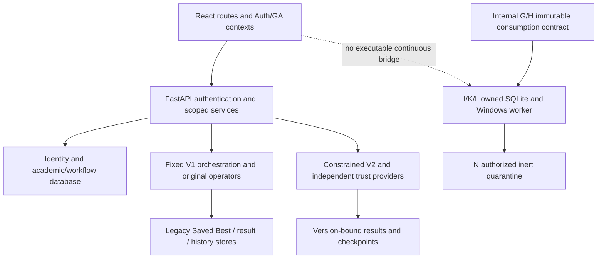

# U5O — full-system functional audit and seven-day research readiness

Audited 2026-11-09, Asia/Manila. Baseline: `main`, U5N `30af999939146dbf818b9d86caa66646da46c5cf`. **Audit complete with findings; seven-day experiment NO-GO. Production admission BLOCKED, Continuous Optimization DISABLED, active checkpoint restoration BLOCKED.** No production correction, provider activation, database operation, staging, commit, push or deployment was performed.

The application supports a real, isolated fictional workflow from constrained V2 generation through a faculty request, independent Chair decision, controlled application and refreshed faculty timetable. This does not establish a complete institutional application or a continuous research release. The K/L native worker foundation remains separate from the public dashboard. Its maximum wall budget is 600 seconds. None of the 30-minute, 6-hour, 24-hour or 168-hour gates ran.

Two application issues were reproduced: an ancillary history outage clears a valid application preview, and legacy Saved Best eligibility compares scores across incompatible contexts when subject keys match. The latter was characterized using the actual decision function with mocked fictional payloads and an in-memory writer; no real Saved Best was read or changed. A separate Windows resource test exceeded its unchanged CPU bound before passing on an unchanged rerun. That qualification failure remains unresolved.

## Scope, evidence and counting

The [feature matrix](testing/dashboard-u5o/feature-matrix.json) contains **48 capability groups**:

| Status | Groups |
|---|---:|
| WORKING | 16 |
| PARTIALLY WORKING | 23 |
| BROKEN | 2 |
| PLACEHOLDER | 1 |
| INTENTIONALLY DISABLED | 4 |
| NOT TESTED | 2 |

These are scoped capability groups, not a completion percentage. WORKING applies to the stated fictional boundaries and evidence, never to unexamined institutional sources. A group may include untested control permutations, explicitly recorded in its limitation field. The placeholder group consists of fourteen empty, unreferenced source modules; it does not mean fourteen visible placeholder pages.

The final [frontend inventory](testing/dashboard-u5o/frontend-static-inventory-r3.json) covers 111 TS/TSX files, 24 React Route declarations, **20 page routes**, and 22 canonical URLs including the root redirect and wildcard. It identifies **366 authored static JSX sites**: native controls, forms, links, dialogs, tables, charts and calendars. Repeated list definitions count once; third-party generated controls differ. The [control classification](testing/dashboard-u5o/control-classification.json) conservatively records 17 WORKING, 7 PARTIALLY WORKING, 1 BROKEN, 1 INTENTIONALLY DISABLED and **340 NOT TESTED** sites. Rendering alone never qualifies every button.

The final real-browser survey visited all twenty pages and recorded **416 mounted control occurrences**, including hidden DOM elements and repeated navigation. It records visibility, labels and HTTP method/path/status, without values, headers or bodies. It did not click every control. Its first heading is sometimes the common application brand, so neither heading presence nor HTTP background polling establishes the full page workflow.

The effective FastAPI registry contains **103 method/path pairs on 98 paths**, plus four framework documentation/OpenAPI entries. A new actual TestClient probe received 401 from all **100 protected method/path pairs**. Public root/health returned 200 and malformed login returned 422. This verifies anonymous denial in the isolated fixture, not every authenticated authorization permutation or a security certification.

## Architecture and traceability



The [backend static inventory](testing/dashboard-u5o/backend-static-inventory.json) maps 121 modules, 1,001 AST function definitions, 37 persistence/configuration symbols, six ORM modules and six migration files. Function counts include helpers; they are not API counts. Nine VS Code development tasks were inspected. Scheduling-related source references include worker heartbeats and ordinary schedule functions, not proof of Windows scheduled tasks. No deployed application Task Scheduler service was established; unrelated OS task inventories were not exported.

The [frontend-to-backend matrix](testing/dashboard-u5o/frontend-backend-traceability.json) maps twenty page import closures, handlers, URL templates, effective routes, inherited dependencies and direct service calls. It includes 64 filtered HTTP/helper call sites. Shared imports create 257 potential page-to-call links: 195 static matches and 62 dynamic/manual-review links. Dynamic builders and provider-originated calls are explicitly unresolved; those links are neither proven broken nor claimed end-to-end verified. The retained r1/r2 scanner outputs document counting refinement; r3 is canonical.

| Route family | Handler → HTTP/service → response/UI finding |
|---|---|
| `/login`, account menu | AuthContext → real login/me/logout → SQL sessions → role routes. Actual login/reload/logout passed; no institutional SSO claim. |
| `/admin`, `/faculty` | Dashboard navigation and status cards; actual route load. Card rendering is not a resource completeness check. |
| `/admin/accounts` | Account handlers → auth account/binding routes → identity tables. Actual list response and backend lifecycle tests; fresh complete creation/binding browser journey NOT TESTED. |
| `/faculty/profile` | Own metadata API → verified UUID/code binding → read-only profile. Actual GET passed; complete institutional roster/allowance metadata unavailable. |
| `/faculty/preferences`, `/admin/preferences` | Editor → owned/admin preference APIs and eligibility metadata → JSON-backed preferences → refresh. Actual fictional save/reload passed. All drag/rank/calendar variants NOT TESTED; admin initial metadata error has refresh guidance but no independent inline retry. |
| `/admin/subjects` | Catalog/filter APIs and SubjectDrafts. Actual SYN101 read passed. Draft entry is React page state, explicitly temporary; no durable academic CRUD/GA activation. |
| `/admin/faculty`, `/admin/rooms` | GAContext schedule → selectors → WeeklySchedule. Assignment viewers, not authoritative faculty/room/availability administration. Zero-assignment faculty are absent from the schedule-derived selector. |
| `/admin/external-schedules` | Intake/review/readiness/handoff/ledger handlers → protected preview and confirmation APIs. Parser, reconciliation, receipt, transaction and authority regressions passed; actual confirmed ledger read passed. Fresh complete CSV/XLSX/confirmation-authoring and native print journeys NOT TESTED. |
| `/admin/generate` | Fixed V1 GAContext and separate constrained V2 panel. Actual fictional V2 check/start/result passed. Fixed controls/intercepted browser passed; actual V1 stream → working Live Center NOT freshly verified. |
| `/admin/schedules`, `/admin/analysis` | V1 shared result versus separately versioned V2 result/provenance. Actual V2 proposal and original score 30 rendered; this is dataset-specific, not the 455 parity fixture. Missing current V1 latest in the fixture produces an explicit empty/error state, not invented results. |
| `/admin/chromosomes`, `/admin/history` | Saved/uploaded payload and history APIs → file-backed archives/export. Read-only route survey and backend regressions; full native download/import browser journey NOT TESTED. Saved Best cross-context risk below. |
| `/faculty/schedule`, `/faculty/adjustments` | Own schedule → revision-bound draft/validate/submit/history → workflow tables. Actual ownership, request and post-application refresh passed, including faculty with no assignments. |
| `/chair/requests` | Independently scoped queue/filter → fresh review → approve/reject → immutable decision. Actual filtered approval passed; API rejection tests passed. Not all UI rejection/withdraw variants were clicked. |
| `/schedule-applications` | Independent application authority → approved queue/preview/apply/version history. Actual rollback, concurrent application and published history passed. History-only outage still incorrectly clears a valid preview. |
| Continuous mode / Live Center | Readiness GET and existing fixed-run status presentation. Disabled Start is intentional. Internal K/L admission/control is not installed as public continuous endpoints. |

## Roles and authority

| Principal | Verified fictional journey | Limit / required authority |
|---|---|---|
| Faculty | Session → preferences → own proposal/published timetable → adjustment → status/history | Binding required; no client faculty identifier grants ownership. Requests do not approve or publish. |
| Administrator | Catalog/ledger read → confirmed-scope V2 generation → proposal and analysis | Admin does not imply Chair appointment, institutional GEC confirmation or publication authority. |
| Department Chair | Independent fictional appointment → department queue/filter → review and approval | Chair approval authorizes the proposed adjustment only; it is pending application. |
| Authorized scheduler | Separate fictional application grant → fresh complete-schedule validation → atomic apply/new immutable version | First baseline designation came from an explicit fixture handoff, not a production UI or institutional approval. |
| Research-demo operator | Internal fictional SDK authority/owner/bundle tests | No user-accessible research profile or trusted continuous HTTP/UI operator exists. Do not replace production authority with an admin flag. |

Chair and application pages contain their own Auth guards even though they are outside the general protected layout wrapper. Backend authorization remains independent. Default providers remain unconfigured; no bypass was introduced. Actual role/scope/replay/stale/failure cases use fictional providers and owned SQLite. Real public institutional authority is still unavailable.

## GA pipeline and academic correctness

**Fixed V1:** request/authentication → run registry/control boundary → input loading/preflight → frozen preferences/settings → original population construction → tournament selection/elitism → faculty-swap crossover and mutation → original fitness → survivor admission/best-ever → publication validation → legacy Saved Best decision → router result/history persistence. `ga_service.py` calls `save_best_if_better` before its final return; a router-only compatibility check would be too late. Fixed pause/resume/stop uses its existing strict checkpoint policy.

The original Python model/operator exports remain authoritative. Notebook sources remain preserved, but the live FastAPI path does not execute notebooks. Chromosomes contain Subject meeting/resource graphs with faculty, room, section and time-block state. Module-level CSV/runtime templates and cached metadata mean a source fingerprint or client label alone does not prove actual consumption. U5D legacy observations remain UNVERIFIED; G/H immutable capture/loaded-model contracts are separate.

**Constrained V2:** independent current D9 revision/evidence checks → bound term/scope and immutable commitments → run-local constrained templates → candidate admission before selection/best-ever → unchanged original operators and numerical scoring → strict bound checkpoint and publication checks. External commitments stay outside genes and fitness. Input invalidity and bounded search exhaustion are different outcomes. Successful generation is not institutional approval or proof of mathematical optimality.

**Internal H/I/K/L/N:** immutable bundle → verified internal optimizer → owner/run/config/version/lineage-bound private SQLite → bounded process batches and checkpoints → Windows JobObject supervision → independent recovery authority and inert quarantine. These contracts do not silently redirect fixed endpoints or promote legacy receipts. N does not restore an active worker or overwrite historical checkpoints.

The original nonzero fixture was rerun through original and worker paths: **455.0 = 455.0**, with equal assignments, history, component breakdown, faculty accounting and RNG state; global RNG unchanged and no Saved Best promotion. Five parity tests and ten legacy binding/continuation qualification tests passed. The six retained historical fixed-engine checkpoints remain byte-identical; previously documented incompatibility is not repaired or reinterpreted by U5O.

Important preserved academic limitations:

- The legacy GA faculty pool is built from legacy preference CSV records, not all registered accounts or a qualified complete IT roster. Missing submitted JSON preferences and a missing legacy cohort row are different cases. F1/F1.5 remain blocked on the authoritative cohort source; IT prototype data does not establish full CCS/IS coverage.
- Option B calculates expected teaching units as `max(0,24-admin-research-extension)`. Allowances are fixed inputs, not scheduled outputs. Above 30 units warns; 40 is the hard ceiling. This describes current code/project policy, not new institutional approval.
- The preserved quantized workload score has the verified counterexample `[2,2] = 500` versus `[4,0] = 475`. Lower is better, so it can prefer concentration. Experimental alternative-policy evidence is not an activated production fix. Zero-target positive teaching requires a separately qualified exception authority under the developer policy; do not assume the baseline implements that authorization.
- Explicit subject eligibility is mandatory. Descriptive specialization/domain metadata does not establish an approved soft alignment objective or empirical satisfaction metric.
- Legacy reset helpers reopen faculty/room availability booleans; section closures persist. Temporary bookings and authoritative closures need a versioned ownership contract. V2 immutable external commitments are a separate path. `PreassignedAssignment` fixes resources, not meeting day/time.
- Existing coverage, conflict, eligibility, grid, availability and workload validators were exercised with fictional inputs. This does not prove completeness of institutional courses, capacities, closures, preferences or terms.

## Database and persistence boundaries

The six unchanged migration sources form `4a_0001 → 4c_0001 → d9_0001 → d11_0001 → d12_0001 → d13_0001`. The ORM map covers nineteen named identity, academic, GEC, request, Chair and application tables. SQLite fixture schema construction and actual transaction/rollback/concurrency tests are not live execution of PostgreSQL migration DDL.

Deployment `database.identity_engine()` accepts configured PostgreSQL URLs, caches the engine, uses bounded connection/statement/lock timeouts and hides parameters. Startup does not automatically create tables or migrate. `/api/health` is a liveness endpoint, not a database readiness certificate. No credential values or connection URLs were inspected/exported.

The D15 historical acceptance remains **17 Phase 4C and 10 workflow tests**, retained `d13_0001`, with its existing evidence preserved. U5O did not connect to that database or verify its present live state. PostgreSQL service availability is an OS observation only. No institutional or retained D15 rows/schema/permissions were changed by this work.

File-backed preferences/settings, latest results, Saved Best, snapshots and fixed checkpoints remain separate from workflow SQL and owned worker SQLite. The complete persistence symbol map is in the backend inventory. The new tests forbid non-owned database connection and legacy save/checkpoint paths where relevant. All writes occurred in disposable fictional test namespaces, never application stores.

## Reproduced findings and priority

The [eighteen-item repair backlog](testing/dashboard-u5o/repair-backlog.json) includes reproduction, expected/actual behavior, cause, severity, dependencies, proposed fix, acceptance criteria, required tests, complexity and proposed milestone for each item. The [CPU follow-up](testing/dashboard-u5o/resource-quota-followup.json) adds a specific nineteenth action under the existing host-resource gap; it does not add a forty-ninth feature group.

| ID | Priority / classification | Established finding | Proposed next action, not implemented |
|---|---|---|---|
| O-P0-01 | Conditional data-integrity risk | Legacy save decision checks matching subject keys and raw fitness, not compatible input/config/policy context. Mocked foreign score 90 replaces 100; 110 does not. No real corruption observed. | Keep research namespaces isolated; separately approve version-aware persistence eligibility. Do not patch Saved Best casually. |
| O-P1-01–05 | Intentional gate / integration gaps | No fictional operator HTTP bridge, 600s/20-generation cap, bounded lineage/retention, incomplete host budgets and research telemetry/export. | Design a versioned, gated fictional release and its limits. |
| O-P1-06–08 | Institutional/policy dependencies | Cohort source, fairness/zero-target integration and authoritative availability remain qualified only in separate contracts. | Resolve approved inputs/policies without inventing records. Fictional demo can use explicit complete fictional inputs. |
| O-P1-09 | Intermittent resource-bound failure | One-second native CPU test terminated at **5.109375 user seconds**, failing `<5`; unchanged rerun passed at **2.3125**. | Investigate accounting/enforcement timing; strict one-second termination is not proven. No arbitrary threshold increase. |
| O-P2-01 | Actual UI defect | History-only 503 after fresh preview clears detail and Apply. Backend preview still 200 and `can_apply=true`; history is 503. | Separate ancillary history error/retry from authoritative preview. Retain fail-closed stale/authority/preview checks. |
| O-P2-02–06 | Workflow/data/test gaps | First designation fixture handoff; resource viewers/drafts are not CRUD; flat route introspection can miss lazy routers; actual V1 Live Center untested; specialization rubric absent. | Targeted workflow/test work and policy qualification. |
| O-P3-01–02 | Usability/scale | Long-history presentation untested; admin preference metadata retry requires refresh. | Measure scale after correctness; add guarded retry only in an authorized repair scope. |
| O-P4-01 | Unused scaffolding | Fourteen unreferenced empty modules. | Leave unchanged; cleanup is deferred. |

For O-P2-01, `ScheduleApplications.open` awaits both preview and `publishedVersions`; the shared `run` catch clears detail, confirmation and history. Real Edge scenario **U5O-A01** reproduces this, captures the blocked UI, removes only its fixture fault, and verifies recovery before continuing. Its PASS means the defect was successfully characterized, not that desired behavior passed. No application fix was made.

The initial audit also exposed an audit-infrastructure assumption: this installed FastAPI uses lazy `_IncludedRouter` entries. The first new audit test failed rather than silently omitting routes. Correct effective route traversal and an OpenAPI coverage assertion now inventory all registered application paths. This did not change application routing.

The CPU test sets and queries back the JobObject cumulative process user-time limit. Native enforcement/observation returned the values above; the precise overshoot cause remains unresolved. A successful rerun is insufficient to dismiss the failure as harmless or claim a strict CPU deadline. Its transient observation can show one active process before final close; both runs' cleanup assertions require zero afterward. No orphan was established.

## Continuous and seven-day readiness

K allows at most 600 wall seconds, twenty generations and population eight. Its default wall budget is 120 seconds, four generations and eight retained checkpoints. L qualifies child private committed memory (default 768 MiB), cumulative user CPU (default 60 seconds per batch), process creation/identity and cleanup. These are not parent/host RAM, total RSS or CPU-rate guarantees. L keeps one backup and at most 64 process attempts. N chains are bounded to eight and restoration remains quarantine. I's default seven-day retention is not sufficient justification for a future experiment that itself lasts seven days plus recovery/review time.

There is no durable public continuous telemetry/result/export bridge, no browser reconnection acceptance for that worker, no approved long-run retention/rotation/freshness/old-owner fencing policy, and no deployed parent supervisor. Repeated fresh fixed runs or an enormous fixed generation count would not establish one continuing population/RNG/best. Continuous UI remains disabled.

Read-only [machine evidence](testing/dashboard-u5o/machine-readiness.json):

| Observation | Value / interpretation |
|---|---|
| Host | Windows 11 Home Single Language, build 26200; Core i5-12500H; 12 physical / 16 logical cores |
| RAM at inspection | Total visible approximately 15.71 GiB; free approximately **1.69 GiB**, a point-in-time value |
| C: free space | 49,325,969,408 bytes, approximately 45.94 GiB; no seven-day growth estimate justified |
| Power | OEM Acer plan; sleep-after values zero; **AC idle hibernate 43,200 seconds (12 hours)**; DC hibernate zero |
| Lid/power/sleep buttons | Sleep actions; lid closure can interrupt the experiment |
| PostgreSQL | Windows service running; no server connection/version/current database verification in U5O |
| Developer backend | Uvicorn `--reload` development launcher, not a seven-day supervisor |

No power, firewall, credential, GC or allocator setting changed. A 12-hour idle hibernate setting does not prove a busy GA will hibernate at precisely twelve hours. It is an unresolved operational risk requiring an approved plan, alongside updates, power loss, reboots and lid closure.

One measured fictional H/I run (two faculty/two offerings, population two, one generation) took **2.503477 seconds** across initialization/pause and continuation. Its one durable checkpoint was **150,304 bytes**; the timed Store call was **15.657 ms**, including validation/transaction work but excluding optimizer graph encoding/decoding. SQLite size was 262,144 bytes. Sampled working-set peak was **221,507,584 bytes (~211.25 MiB)** with 41 samples at 50 ms; process-lifetime peak was 254,709,760 bytes and includes imports. Private commit was separately 684,490,752 before and 697,024,512 after; it is not RSS. Final fitness was zero; no convergence claim. These are one instrumented tiny trial, not a scale benchmark or seven-day forecast.

The [duration gates](testing/dashboard-u5o/seven-day-gates.json) define 30-minute → 6-hour → 24-hour → 168-hour acceptance, each **NOT RUN / current NO-GO**. Prerequisites include approved versioned duration/continuation, owned telemetry/storage/recovery, prior shorter gate success, representative headroom and user-approved power/restart handling. Stop on context/lineage/owner mismatch, invalid successful schedules, best-ever regression/NaN, missing mandatory telemetry, corruption, resource/disk floor violation or unsupported suspend/resume.

A proposed start floor of 2 GiB free physical RAM and 10 GiB free disk, with 5 GiB disk stop floor, is an **unapproved engineering proposal**, not an enforced policy or measured adequate budget. Present RAM is below that provisional start floor. Representative inputs and full parent/helper topology must be measured before choosing real limits. No generation-count promise, log-growth estimate or throughput forecast is supported.

## Research metrics and exports

The [nineteen-row metrics inventory](testing/dashboard-u5o/metrics-availability.json) distinguishes stored, derived, partial and unavailable observations. Existing genuine GA observations include initial/best fitness, generation histories, improvement events, workload analyses and some candidate-bound preference matches. Zero fitness is preserved; lower is better. Stagnation is not proof of global optimality.

Required gaps include explicit active/paused/wall/validation time bases, durable continuous generation/events, complete required-offering/cohort denominators, seed/release/configuration export, interruption history and one compatible context throughout comparisons. `fitness_evaluations_total` is null; do not present it as zero or an evaluation rate. Generations per elapsed time is a different metric.

Specialization alignment and an approved historical IT comparator are unavailable. Mechanical subject/day/time preference matching is not empirical faculty satisfaction. Formal adviser-approved methodology/manuscript and institutional evaluation data remain unverified. No thesis compliance or institutional readiness claim is made.

Existing history JSON/CSV and research benchmark artifacts do not form an integrated continuous research package. A later contract should supply configuration/seed/provenance, generations, improvements, faculty metrics, violations, checkpoints, interruptions and failures in versioned JSON/CSV, plus charts with units and a thesis summary. It must export missingness and failed trials, never invent values or rescore historical inputs using changed preferences.

## Fresh verification and retained failures

All execution records are retained in the [manifest](testing/dashboard-u5o/manifest.json) and [attempt reconciliation](testing/dashboard-u5o/test-result-reconciliation.json). **Final selected Python results: 1,048 passed**, including the one live-browser wrapper. This is not the sum of repeated attempts.

| Final selection | Passed |
|---|---:|
| New U5O route/measurement/Saved Best characterization | 3 |
| D1–D16 dashboard backend suite, excluding live wrappers | 458 |
| Fictional resource regressions | 8 (1 data-dependent case explicitly deselected) |
| D10 V2 engine / API | 30 / 18 |
| U5A–C compatibility/context/source | 99 |
| U5D race / receipt suite | 19 / 36 |
| G/H consumption / bundle / parity / legacy | 39 / 32 / 5 / 10 |
| I/J admission / qualification | 50 / 49 |
| Deployment identity / preference scope | 16 / 3 |
| Advanced analysis / readiness | 20 / 20 |
| Windows native / supervised / bounded worker | 12 / 41 / 32 |
| Recovery / parent containment | 40 / 7 |
| Real Edge/FastAPI/SQLite wrapper | 1 |

Frontend **385 contracts passed**, TypeScript passed, production Vite build passed and focused ESLint passed. Build retains ineffective-dynamic-import and large-chunk advisories; no dependency or chunking changes were attempted. Backend logs retain Starlette/httpx and anyio deprecation warnings; dashboard migration-render tests also report Alembic legacy `prepend_sys_path` splitting. Warnings were not suppressed or attributed to unobserved causes.

Real browser: **Edge 156.0.4314.50**, Node 24.11.1; **21 original journey scenarios + 1 expected-defect characterization + 1 twenty-page render/network survey = 23 PASS observations**, no recorded runtime JS errors. This is actual Edge → loopback FastAPI → owned SQLite, with fictional providers. It is not PostgreSQL, an active continuous worker, institutional publication or proof that all 366 controls work. First successful live run had 22 scenarios; its evidence remains and is not added to final coverage.

Separately, **16 intercepted-HTTP Edge scenarios passed** (17 Node runner tests including the parent). These verify UI handling of fictional responses, not real GA/authorization/database execution. Thirty-six PNGs were retained; all 31 distinct byte sequences were visually reviewed, with five byte-identical replays covered by their SHA-256. PNG CRC/metadata verification is separate from visual review. Earlier screenshots with not-yet-populated calendar layout were retained; final captures show populated assignments. Screenshots alone are not assignment-completeness proof.

Four unsuccessful command records remain intact:

1. `022625` U5O audit: 1 failed / 1 passed, new audit's flat-router assumption. Corrected only the new test; final three pass.
2. `023230` live wrapper: 1 failed before scenarios, snapshot could not resolve Vite. Added owned dependency junction, no installation; final live run passes.
3. `024816` original resource selection: 1 failed / 8 passed. It expects real ITE184 sections excluded by fictional bootstrap. Institutional-data preflight remains unverified; later fictional selection explicitly deselects it.
4. `031020` native suite: 1 failed / 11 passed, CPU overrun. Unchanged rerun 12 passed; boundedness concern remains.

No PostgreSQL operation, migrations against a live server, native print dialog, full export download, long-duration run or new performance optimization was executed. U5O does not replace previous D15 PostgreSQL evidence with SQLite results.

## Preservation, exact inventory and checkpoint proposal

Entry state was verified: eleven pre-existing tracked modifications, 958 pre-existing unrelated untracked files, empty index, and local/last-fetched `origin/main` at U5N. No fetch was performed during this audit; live remote synchronization is not newly asserted. A later checkpoint must fetch and reverify.

The [raw baseline](testing/dashboard-u5o/preservation-baseline.json) covers **4,447 paths**, including the Git index, all 23 academic paths, both protected JSON files, original Python/notebook/scoring/RNG sources, migrations, six historical checkpoint payloads and their status/history trees, Saved Best, retained temporary historical evidence and existing unrelated work. Final replay requires every byte to match; hashes establish preservation, not institutional correctness. The committed G–N manifests supply 819 historical artifact-hash references, rechecked separately. No original evidence was rewritten or deleted.

**Existing files modified by U5O: none.** The only new file outside its documentation tree is `backend/tests/test_full_system_audit.py` (three characterization/measurement cases). New tooling is under `docs/testing/dashboard-u5o/`: source scanners, disposable snapshot runners, the route-survey fragment, analysis builder and read-only evidence auditor. Generated JSON, genuine PNGs, this report, manifest and plan comprise the rest. The exact path-by-path new-file inventory and raw SHA-256 identities are authoritative in [manifest.json](testing/dashboard-u5o/manifest.json); the exact proposed Git groups/blob identities are in [staging-plan.json](testing/dashboard-u5o/staging-plan.json). The manifest excludes its own hash; the plan is hashed after creation and cannot contain its own blob identity.

All eleven original tracked modifications remain excluded: the protected preferences/settings; five Live Center chart/console components or styles; FitnessAnalysis, GenerateSchedule and SubjectManagement; and the existing evaluation-coverage browser test. The 958 unrelated untracked files remain untouched. The actual UI checks copied **21 entry-inventory frontend files** into disposable committed snapshots. Thus the working UI is verified in that declared overlay, while the proposed audit-only checkpoint does **not** independently qualify a different UI obtained by committing only U5O. Do not stage unrelated frontend changes to conceal this distinction.

Privacy checks cover encoded complete/truncated receipt/token patterns, authentication/header/key/credential-URI patterns, local private-name comparison without exporting those names, and PNG visual/CRC/metadata review. No raw database, checkpoint, backup package, HAR, cookie/header dump or credential-bearing URL is archived. Fictional public record/version IDs and digests are not authentication receipts. Failed evidence was retained and checked too.

Non-mutating Git whitespace/index checks, new text whitespace/compile checks, raw artifact hashes and Git integrity checks are replayed by the auditor. Nothing is staged. The exact inventory is ready for **separate selective audit-checkpoint review**, not an automatic commit or an application/experiment release. Proposed groups: audit test/tooling, then report/inventory/diagnostic evidence. Use exact literal paths with `core.autocrlf=false`; no partial staging is required because all U5O paths are new. The plan excludes all unrelated tracked/untracked work and requires a new remote/privacy/hash verification before any future staging.

## Reproduction and recommended U5P

From the repository root in PowerShell, replay only integrity checks after the manifest is sealed:

```powershell
.\.venv\Scripts\python.exe -B docs/testing/dashboard-u5o/audit_evidence.py
```

The following commands are for a deliberately requested fresh fictional execution, **not necessary to finish this audit**. They require the existing local dependencies and Windows/Edge process access; they do not install anything or use database credentials:

```powershell
.\.venv\Scripts\python.exe -B docs/testing/dashboard-u5o/backend_snapshot.py u5o-audit
.\.venv\Scripts\python.exe -B docs/testing/dashboard-u5o/backend_snapshot.py d16-live --working-ui
.\.venv\Scripts\python.exe -B docs/testing/dashboard-u5o/backend_snapshot.py race
.\.venv\Scripts\python.exe -B docs/testing/dashboard-u5o/backend_snapshot.py native
.\.venv\Scripts\python.exe -B docs/testing/dashboard-u5o/frontend_snapshot.py contracts-all build bundle lint browser --working-ui
```

Snapshot tools refuse HEAD drift, use fictional bootstrap/release-byte handling without disabling fingerprints, whitelist child OS environment variables, and write only owned temporary namespaces plus new timestamped audit evidence. Re-running them creates new artifacts that require a new manifest review; sealed evidence is not overwritten. Their generic internal-consumption prerequisite flag is not a claim that every selected test exercised the optimizer; use each test's scope and artifacts.

Recommended **U5P — Targeted Workflow Repair and Fictional Research-Release Contract**:

1. Repair O-P2-01 with independent history state/retry and real-browser regression, keeping fresh authoritative apply validation mandatory. Address lazy-route inventory blind spots in narrowly scoped tests.
2. Resolve O-P0-01 as an explicitly approved version-aware persistence contract. Until then, keep all research outputs isolated from legacy Saved Best; do not silently change eligibility, comparison or checkpoint semantics.
3. Specify a separately gated loopback fictional app factory/operator, server-captured bundle and fresh private stores. Preserve production providers as unavailable, existing endpoints unchanged and institutional publication unreachable. First connect a bounded at-most-ten-minute workflow, with real start/status/pause/resume/stop, reload and restart tests.
4. Define telemetry/export, versioned continuation/deadline/retention and resource/CPU-overshoot qualification before authorizing longer execution. U5Q bounded bridge → U5R storage/resource/telemetry release → U5S increasing stability gates is a proposal, not initiated work.
5. Run 30 minutes, then 6 hours, 24 hours and finally 168 hours only after each prior gate and explicit operational authorization. Keep institutional roster, historical comparator, specialization rubric and genuine authority qualification as separate evidence dependencies.

**Final stop:** U5O does not fix application behavior, activate a demo, modify the GA, establish institutional authority, restore an active worker or begin U5P. The immediate useful next work is a narrow workflow repair plus the versioned fictional-release contract, not performance acceleration or broad cleanup.
