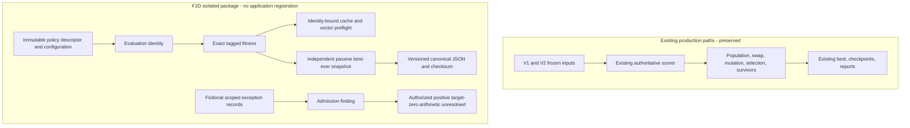

# F2D: isolated versioned fitness architecture foundation

2026-10-31, Asia/Manila. Baseline: `main`, `4d9ee5b4a7d84ae9eb1194e5e5eeb131622a44d2`. **F2D's independently verifiable foundation is implemented and tested. Experimental production scoring remains inactive.** Existing V1/V2 source, fingerprints, checkpoints, inputs and scheduling behavior are unchanged. The protected local preference/settings modifications are preserved as found.

**GO for a separately reviewed, isolated F2E release/dispatch qualification. NO-GO for production scoring activation.** The shared production facade, immutable GA release registry/bundles, full new-policy GA continuation, weight/overload calibration and institutional exception authority are not implemented by this milestone. Connecting them to the current engines would affect fingerprinted source and require the explicit release/compatibility work described below. F2D stops before that boundary.

## Baseline assessment

Read [F2A](workload-fairness-f2a-prototype.md), [F2B](workload-fairness-f2b-implementation.md), the [F2C contract](fitness-policy-f2c-contract.md), its [call-path inventory](fitness-policy-f2c-call-paths.md), source/verification code and relevant tests. F2C's22 artifact hashes verified at entry. This milestone records a fresh1893-path baseline reflecting the newer Git commit; it does not pretend the older F2C Git index/HEAD is still current.

The main scorer is `genetic_algorithm/operators/FitnessFunction.py`. Population construction, V1/V2 orchestration and original swap/mutation implementations call it; swap/mutation compare internally. Tournament and elitism consume score vectors, survivors/best-ever compare again, and saved-best storage compares float totals. `FrozenInputs` pins preference policy/settings/preferences/faculty/input identity, while `FitnessObservation` only records already-computed scores. V2 has no supported alternative fitness callback. Checkpoint graph/reporting guards do not accept raw Fraction instances. The similarly named preference-only utility in `Functions.py` is a different implementation.

Engine fingerprint coverage was inspected before creating source files. V1 hashes all Python under `genetic_algorithm` plus listed services and compatibility/dependency identity. V2 additionally binds its orchestration/store/constraint/trust sources. New files under `backend/experiments/fitness_policy_f2d/` are outside those established collections and have **no import or registration in the application**. Their separate source identity is recorded in the manifest; it is not a replacement GA engine fingerprint.

No production source edit was needed for the independent foundation. Installing a shared production scorer, changing old frozen/checkpoint schemas or widening current graph codecs was deliberately not attempted.

## Architecture and implemented scope



| Component | Implemented in F2D | Boundary |
|---|---|---|
| `contracts.py` | Immutable descriptors/evaluation identities, canonical bounded passive JSON, exact rational DTO/comparison, whole-vector identity preflight, run-local cache, owned passive best-ever, versioned score/best snapshot codecs. | No scorer, GA execution, production dispatcher, model loader, store, endpoint or mode setting. |
| `exceptions.py` | Immutable scoped fictional records, five explicit states, constrained fixture transitions, grant/mandate data contract, admission findings, fail-closed unresolved arithmetic. | Objects supplied by tests are not authentic institutional attestations. No provider, approval endpoint, permission grant, persistence or publication hook. |
| Tests/tooling | Fictional boundary tests; unchanged current V1/V2 engine/checkpoint, audit/reporting and frontend regressions; source, privacy, hash and preservation auditing. | Test records distinguish pure contracts, actual engine/checkpoint execution and Node contracts. No new-policy whole-GA or browser evidence. |

The package is versioned `f2d-isolated-foundation/1`. It can be imported explicitly by standalone experiments. The application never imports it. There is no runtime module replacement, environment mode switch, alternative workload formula or selected production weight.

## Evaluation identity specification

`PolicyDescriptor` binds engine release and fingerprint, fitness policy ID/version, independent preference version, numeric representation, target convention, overload convention, exception admission rule, authorized-zero arithmetic strategy and immutable configuration. `FrozenJSON` captures configuration as canonical bytes; changing the original dict or a returned decoded copy cannot alter it. Raw floats are rejected: a caller must supply an explicit rational or binary64 hex representation when appropriate. No silent normalization/rounding or coefficient defaults occur.

`EvaluationIdentity` adds run, academic year/term, input fingerprint, complete cohort/profile binding, constraint digest, exception-set digest and evaluation scope. Canonical sorted-key ASCII JSON is hashed with SHA-256. Array order and exact Unicode code points remain significant; no ambiguous alias or faculty-name identity inference occurs. Different policy fields, weights/configuration, term/run/scope, inputs, cohort, constraints or approvals yield incompatible identities.

These are identities of **supplied data**, not proof of source authenticity, complete academic records or permission to execute. A future trusted server-owned builder must collect all relevant weights/settings/component definitions and actual source/constraint/cohort identities. Client-provided labels/digests alone cannot replace that builder or an installed release verifier. No automatically captured production descriptor exists yet.

The same identity must propagate through a complete future run:

| Stage | F2D foundation support | Remaining integration |
|---|---|---|
| Initial population evaluation | Tagged score carries context and candidate digest. | Shared facade must evaluate complete hard-valid candidates under frozen server inputs. |
| Parent selection | `preflight_scores` rejects an incompatible vector before any RNG draw. | Wire preflight into all real selection entrances before calling unchanged selectors. |
| Crossover/mutation | Pair comparisons reject mixed identities and support exact ordering. | Original internal scorer imports must resolve to the same release-specific facade. Engine-only final-score replacement remains unsafe. |
| Fitness cache | Cache bound to one immutable identity; candidate-content digest prevents reuse after mutation. Conflicting totals for the same key reject. | A real chromosome content/revision digest and lifecycle invalidation must cover all relevant graph state. Current observational caches remain unchanged. |
| Generation/survivor selection | Exact lower-is-better comparison and compatible-vector contract. | All vectors and comparisons must use the same tagged representation. No changed tie/RNG policy. |
| Best-ever | Strict improvement; stable ties retain original best. Candidate copied to immutable passive bytes; getters return independent trees. Identity/candidate mismatch rejects before replacement. | This is a passive DTO owner, not a copied Subject/Faculty/Room calendar graph. Prove actual graph ownership in a new engine before adoption. |
| Checkpoint creation | Versioned exact-score/passive-best DTO with checksum and bounded canonical decoding. | **Not a GA checkpoint format.** Population, calendars, RNG, frozen inputs and authority must be atomically bound by a separately implemented new GA envelope. |
| Continuation | Supplied expected identity required on decode; incompatible scores/snapshots reject. | New-release GA restoration, full validation and fresh authority rechecks are still required. Original V1/V2 loaders remain authoritative for their formats. |
| Reports/export | Exact numerator/denominator strings round-trip without JavaScript Number conversion. Diagnostic scope is incompatible with whole-chromosome scope. | Versioned API/TypeScript/report schemas and stored component definitions are proposed only. Historical totals must not be relabeled or backfilled. |

Python frozen dataclasses/immutable bytes provide the supported API immutability boundary; they are not a sandbox against malicious Python code using private attributes or reflection. The package assumes trusted experimental callers. It has no hostile-plugin execution interface.

## Comparison, cache, serialization and ownership findings

Exact score values must be Fraction objects internally and reduced numerator/positive-denominator integer strings externally. Mixed identities and untagged numeric comparisons reject. Candidate digests may differ within an evaluation; evaluation identity may not. No epsilon rule or float cast enters ordering. A constructed near-tie above`2^53` preserves exact ordering in tests. This is arithmetic correctness evidence, not an observed production ranking defect or speedup.

Canonical DTOs reject floats/nonfinite values, duplicate keys, unsupported runtime objects, noncanonical ratios, extra fields, unknown score/snapshot format and resource overages (64KiB JSON,4096-bit integers and bounded depth/node counts). Incoming boolean policy versions cannot exploit Python's `True == 1` equality: identity DTOs are compared canonically. Exact-score and passive-best encodings are deterministic; changed candidate data with a recomputed envelope checksum still fails the candidate/score binding.

The cache rejects cross-context get/put rather than returning a prior context's value. Mutated candidate content has a different key and misses. The same key cannot silently acquire a different total. Best-ever input/output mutation does not affect the retained passive payload; incompatible offers leave the prior record intact. Foundation operations do not draw RNG values. No existing deepcopy, GC, allocator or calendar handling was changed.

The codec checksum is corruption detection, not a signature or authority grant. It does not independently recompute a score. A forged but internally consistent passive snapshot cannot become a production schedule because there is no application loader/activation route for this format.

## Compatibility and strict continuation

Fresh original fingerprints match the preserved F2C release:

```text
V1  5dccfbbad87eb42de4bc4fdac2c7a468d857b485e8d6b2149f1f29a43f2ef0b1
V2  0821747e30eb56e9e4c070f369e733bc4b59ec184d2e2cb4c211ffa6fa5c1555
```

No fingerprint function, compatibility manifest or expected source hash was rewritten. Original loader input/source checks, including `GA_CHECKPOINT_INPUT_CHANGED`, remain intact. Original graph/report validators still reject raw Fraction values. Experimental DTOs are not submitted to those loaders.

[Fresh V1 mirror evidence](testing/fitness-policy-f2d/20261031T165847052783+0800-v1-mirror/command.json) verifies148 copied source files byte-identical and three actual fictional checkpoint archives. The unchanged four-test worker runs original generation/operators, writes and loads real checkpoints, pauses at generations0/1/2 and compares continued schedules, full histories, fitness breakdowns, analysis and RNG with uninterrupted runs. The owned mirror contains newly generated empty CSV schemas and fictional/default JSON, with a genuine input fingerprint `b803fa98ae3a527e7c020e17173063e190a1c55ca37f3de17c7c6f1f61415e95`. The original engine fingerprint is unchanged; no institutional input was copied or parsed. Archive integrity/source-input equality is checked before owned temporary cleanup. Existing historical checkpoints are not used as writable fixtures.

The final legacy selection includes30 original V2 tests: actual current checkpoints/read/resume and fresh-process continuation, best-ever/RNG behavior, corruption/input/profile/constraint rejection, real original operator behavior, bounded search failures and authority loss before writes. They demonstrate preserved current behavior, **not new-policy continuation**.

The six retained historical artifacts retain their documented pre-existing incompatibility and remain byte-identical. No silent migration, source spoofing or compatibility fabrication occurs. Historical readability does not establish current authorization. Future workload policy changes need a real new release identity and independently reviewed immutable release registry/bundles. Checkpoints must never supply executable paths/modules. A legacy artifact cannot resume as a different scoring policy; an explicitly revalidated seed for a new run must be labeled as such.

## Zero-target Option A contract

Option A is recorded as the developer-approved direction. IT remains the available prototype scope; this decision does not establish institutional approval or full CCS coverage. T0/A0 is allowed. Positive teaching against target0 requires a scoped, current, explicitly authorized exception. The original target remains0. Authorization cannot override eligibility, faculty/section/room conflicts, closures, valid times or the applicable40-unit ceiling.

`ExceptionRecord` distinguishes `NOT_REQUESTED`, `REQUESTED`, `AUTHORIZED`, `REJECTED` and `REVOKED`. Fixture transitions create new frozen records; they are not approval commands. Rejected/revoked records cannot be silently reauthorized by a transition. A future new request/revision needs an explicit lifecycle policy and durable event history.

Scope binds faculty, department, year/term, scheduling context, policy/profile/cohort/input/constraint digests and approved offering IDs. The grant retains approval/revision/event, issuer-policy identity, teaching-unit bound and aware issuance/expiry. Attested capability must be the separate `zero_target_workload_exception.authorize`, with matching issuer/jurisdiction and a current mandate. Chair request-review, schedule application, GEC confirmation or administrator login do not automatically grant it. An unavailable/invalid attestation rejects positive admission.

Changed faculty, term, profile, cohort, inputs, constraints, policy, offering scope or pinned grant triggers rejection/revalidation. Bind the pre-exception scheduling context and then include immutable grant pins in the evaluation exception-set digest; do not create a self-referential hash where an approval must sign a digest containing its own approval. The future server builder/pinning transaction is not implemented here.

The fictional provider facts used by tests are **not real authorization records**. No appropriate institutional exception workflow/provider exists in the inspected application. Repeated production-provider factory checks in the F2C regressions confirm existing trust remains blocked. A real implementation still needs an institutional issuer mandate, persistence/audit provenance, fresh revocation checks and transaction-safe pinning before evaluation, continuation and publication.

An authorized positive exception returns `allowed=True, numeric_ready=False`. `require_numeric_policy` then rejects with `AUTHORIZED_ZERO_TARGET_ARITHMETIC_UNRESOLVED`. This separates admission from the undefined`A^2/0` arithmetic. No denominator1, target change, exception weight or favorable-score bypass is introduced. Existing production legacy behavior has not been retroactively changed to enforce Option A; activation of a new guarded policy requires separate integration and compatibility qualification.

## Fresh results and retained unsuccessful attempts

Final unique selections: **272 Python/backend/contract tests and42 frontend contracts passed**, zero final failures/errors/skips. Repeated/intermediate passes are not added.

| Selection | Fresh pass count | Evidence/meaning |
|---|---:|---|
| New foundation + preserved F2C contract regressions |178 (98 new +80 prior) | [Final record](testing/fitness-policy-f2d/20261031T170959940611+0800-foundation/command.json). Pure contracts, exact serialization, immutability, cache/best isolation, exception states and negative cases. |
| Legacy/backend selection |90 (4 new +33 audit +30 V2 +23 reporting) | [Final record](testing/fitness-policy-f2d/20261031T170706619423+0800-legacy/command.json). Original hard/soft behavior and reporting, real fictional V2 execution/continuation, authority protection and high-level text guard. |
| V1 mirror |4 | Three real current checkpoint continuation fixtures and original strict-loader characterization. [Record](testing/fitness-policy-f2d/20261031T165847052783+0800-v1-mirror/command.json). |
| Frontend compatibility |42 | [Node record](testing/fitness-policy-f2d/20261031T165743478087+0800-frontend/command.json). Existing reporting/preferences/faculty-display/constrained-GA contracts; not browser scenarios. |

The original F2A/F2B equal-target result remains balanced500 versus concentrated475, with original full component breakdowns archived in [legacy-score-equivalence.json](testing/fitness-policy-f2d/20261031T170706619423+0800-legacy/legacy-score-equivalence.json). This is intentional preservation; the fairness correction is not active. The F2C exact-arithmetic counterexample tests are also freshly run without installing that formula in an engine.

Three warnings in the final legacy selection: existing AnyIO assertion-rewrite bootstrap, Starlette/httpx TestClient deprecation and BlockingPortal alias deprecation. No dependencies were installed or warnings suppressed. Pure foundation tests disable unrelated pytest plugin autoload for isolation; the actual legacy engine tests retain existing plugin behavior. No production build/browser or new API integration was needed/performed because no frontend/endpoint changed. No new-policy performance measurement was performed; test elapsed times are not GA speedup claims.

Unsuccessful evidence is preserved and reconciled:

- Initial foundation:169 passed, two setup/teardown error reports for **one** oversized-input test. Pytest used the full65,537-byte payload as a node ID, exceeding Windows' environment variable limit. Short explicit IDs preserve the full rejection input/assertion. [Diagnosis](testing/fitness-policy-f2d/initial-test-diagnosis.json).
- V1 wrapper bootstrap: Git refused source listing under a sanitized environment lacking ambient ownership configuration. Tests/checkpoints had not begun. The new wrapper now uses byte-verified paths from the saved baseline. No Git configuration, permissions or fingerprint was bypassed. [Retained record](testing/fitness-policy-f2d/20261031T165742371330+0800-v1-mirror/bootstrap-error.json).
- New process read guard:50 passed/39 failed because the guard misclassified actual binary input-fingerprint reads. No application correction was needed. [Diagnosis](testing/fitness-policy-f2d/audit-guard-diagnosis.json).
- Guard-helper tests:170 passed/six failed from a `run_checks.py` basename collision with F2C during pytest collection. Explicit source-path import of the new test helper fixed the harness; no production aliases changed. [Diagnosis](testing/fitness-policy-f2d/test-module-collision.json).
- Follow-up transport probe:175 passed/one failed, disproving the assumption that Windows open audit flags distinguish Python text and binary wrappers. The final probe records their ambiguity. Existing `data_guard` at Path/io/builtins/pandas boundaries enforces text rejection, proven on an owned fictional file; the process hook independently blocks database/network access and baseline writes. [Diagnosis](testing/fitness-policy-f2d/audit-layer-diagnosis.json).

No original test was disabled, academic rule changed or timeout increased to obtain passes. The harness mistakes and disproved assumptions are distinct from application regressions. Intermediate successful176/89 selections remain narrower historical attempts, not additions to the final total.

## Files, preservation and reproduction

Existing files modified by F2D: **none**. New implementation files:

- `backend/experiments/fitness_policy_f2d/__init__.py`
- `backend/experiments/fitness_policy_f2d/contracts.py`
- `backend/experiments/fitness_policy_f2d/exceptions.py`

New verification files under `docs/testing/fitness-policy-f2d/`: `test_foundation.py`, `test_legacy_boundary.py`, `run_checks.py`, `verify_v1.py`, `audit_evidence.py`, pre-edit binary baseline, retained diagnoses, timestamped evidence and manifest. This report is the only new Markdown file. The [manifest](testing/fitness-policy-f2d/manifest.json) provides the exact complete file inventory and raw artifact/source hashes; it excludes its own hash.

The final audit checks all1893 baseline paths, all23 academic files, protected local preference/settings bytes, Git index, existing original GA/scoring/RNG, migrations, checkpoints, schedules and earlier evidence. It independently rechecks502 prior artifact entries, preserves earlier failed evidence and checks new text syntax/whitespace, Git whitespace and privacy patterns for complete/truncated encoded material, credential URLs, private keys and sensitive log/header assignments. New evidence is fictional numeric/structural data and sanitized logs; no institutional rows, preferences, credentials or authority payloads are archived. All work stays in isolated Python/test stores, with no PostgreSQL/SQLite connection, database migration/write, dependency installation, staging, commit or push.

From the repository root, existing Windows11 PowerShell/venv and Node:

```powershell
.\.venv\Scripts\python.exe -B docs/testing/fitness-policy-f2d/run_checks.py foundation
.\.venv\Scripts\python.exe -B docs/testing/fitness-policy-f2d/run_checks.py legacy
.\.venv\Scripts\python.exe -B docs/testing/fitness-policy-f2d/verify_v1.py
.\.venv\Scripts\python.exe -B docs/testing/fitness-policy-f2d/run_checks.py frontend
.\.venv\Scripts\python.exe -B docs/testing/fitness-policy-f2d/audit_evidence.py --verify
```

Runners create fresh timestamped output directories, retain prior attempts and use credential/DB-variable-free child environments. `--verify` checks the saved archive and refuses unexpected additional paths; reruns need a separate reviewed manifest update. V1 uses an owned temporary source mirror and the unchanged existing worker; historical artifacts are never rewritten. The initial manifest is created with exclusive file creation after the report/evidence audit, not refreshed silently.

## F2E recommendation and remaining gates

Proceed only with a separately authorized **isolated release/dispatch qualification**, preserving the default engines. Required work remains:

1. Specify and test a trusted immutable release registry/bundle boundary, source/dependency verification and import/process isolation. Keep original supported V1/V2 loaders/fingerprints intact; reject incompatible legacy/new continuation explicitly.
2. Build a server-owned complete frozen descriptor and single scorer facade throughout initialization, operators, survivors, best-ever, caching, checkpoint and reporting paths. No mixed-policy vectors or partial callback injection. No production activation merely because passive contracts pass.
3. Define scalar aggregation/coefficient calibration, legacy-overload composition and authorized target-zero arithmetic. Do not select those policies in infrastructure code. The approved Option B/Option A directions do not settle their remaining numeric details.
4. Establish independent institutional workload-exception authority and durable lifecycle/audit/pinning contracts. D8/D9/Chair/application/publication authority remains separately required and BLOCKED when unavailable.
5. Prove whole-run exact-score behavior, hard constraints, candidate graph isolation, checkpoint/RNG-equivalent continuation and historical reporting in fictional experiments before requesting production integration. Resolve the F1/F1.5 authoritative IT roster dependency without inventing IS/full-CCS records.

F2D establishes a tested foundation and preserves compatibility; it does not claim thesis compliance, genuine institutional authorization, a deployed alternative scorer or complete new-policy GA integration. **No F2E execution, production activation, cleanup, C++ work or Git checkpoint was begun.**
