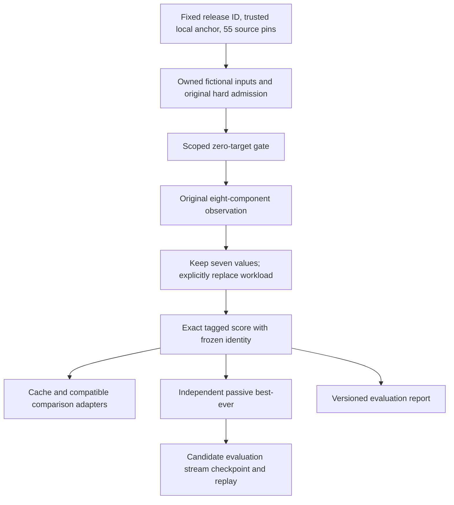

# F2E: isolated fitness release and dispatch qualification

2026-10-31, Asia/Manila. Baseline `main`: `4d9ee5b4a7d84ae9eb1194e5e5eeb131622a44d2`.

**The standalone evaluation release is qualified within the documented fictional scope. Full experimental GA dispatch is NOT implemented. Production scoring remains unchanged and inactive.** The new path evaluates complete scheduled chromosomes through the original hard validator, applies an explicit exact workload experiment, and binds comparison, cache, best-ever, evaluation-session continuation and exports to one frozen identity. It does not replace the scorer inside the original crossover/mutation or run a new-policy GA population.

**GO for separately approved isolated F2F operator-aware release work; NO-GO for production activation or claims of complete new-policy GA continuation/performance.** Physical immutable GA release bundles, shared internal operator dispatch, full population/RNG checkpoints, calibration and genuine institutional exception authority remain gates. No F2F work was started.

## Baseline and architectural boundary

Reviewed [F2A](workload-fairness-f2a-prototype.md), [F2B](workload-fairness-f2b-implementation.md), [F2C](fitness-policy-f2c-contract.md), [F2D](fitness-policy-f2d-architecture.md), the F2C call inventory, F2D implementation/tests and current V1/V2 frozen-input/scoring/checkpoint/trust contracts. At entry, F2D's44 artifacts and its1893-path baseline verified. The new pre-edit baseline covers1938 existing paths, including all45 F2D files and the two protected local data modifications.

The original operators import and compare the legacy scorer internally. V2 has no supported replacement fitness callback; returning new totals only from orchestration would mix objectives. Changing production facades or fingerprinted services is outside F2E. A new source-verified **evaluation adapter** is safe independently of that integration. Comparison adapters for proposed children are tested; they are not silently described as actual original operators using the new objective.

## Release architecture and identity

The unregistered package is `backend/experiments/fitness_policy_f2e/`. Its current release ID is `f2e-fitness-laboratory/1.1`, policy ID `experimental-target-weighted-squared-deviation`, policy version1, arithmetic `exact-rational/1`. No production API, preference/GA setting, cohort provider, permission or route imports/selects this package.



`release.py` resolves only the fixed local release ID/manifest. Caller supplies the expected digest from the test/server-owned anchor; unknown IDs or anchor mismatch reject. Verification checks the exact source path set, each raw source hash, Python version and manifest identity. It never imports a path named by a checkpoint or reconstructs code from payloads. The55 pins cover the new five Python files, all three F2D source files and the original GA/selected verification/constraint/trust dependencies. The bridge additionally verifies the genuine original V1/V2 fingerprints and current frozen inputs. Installed dependency identity continues through the original fingerprints.

Current experimental release identity:

```text
9bf3dd73296e2de27e94c7c80b97a78bb17050d6db5d3b2b5b64ce3fa1ad6fe2
```

This is a new fitness laboratory identity, not a spoof of either production engine. Original identities remain:

```text
V1 5dccfbbad87eb42de4bc4fdac2c7a468d857b485e8d6b2149f1f29a43f2ef0b1
V2 0821747e30eb56e9e4c070f369e733bc4b59ec184d2e2cb4c211ffa6fa5c1555
```

The [first unpublished build](testing/fitness-policy-f2e/20261031T173213692438+0800-prepare/build.json), ID`/1`, was superseded before qualification after code review found that exception Enum states needed explicit passive serialization. The new candidate was explicitly versioned`/1.1`. The [rebuild evidence](testing/fitness-policy-f2e/20261031T173613093579+0800-rebuild-unpublished/build.json), previous manifest and previous anchor are retained in that directory. Only the new `dispatch.py` and `release.py` source pins changed. No checkpoint was created under`/1`, migrated or reinterpreted. The archived old manifest is historical build evidence, not a claim that old source pins verify current files. Runtime verification never refreshes expected hashes automatically.

The trusted-installation/process boundary remains explicit: hashes establish source identity, not institutional authority or protection from malicious Python reflection/monkeypatching inside a trusted test process. A physically independent immutable GA release registry/bundle is still proposed work. The fixed laboratory registry loads no arbitrary plugin or callback; the session requires the concrete verified release, bridge and configuration types.

## Shared dispatch contract: implemented and missing

The bridge owns copies of templates, frozen inputs and preferences. Identity binds the complete supplied cohort, targets/allowances/eligibility/calendars, template graph, preference frame, original input fingerprint, constraint snapshot, term, release and exact experiment configuration. The original raw input fingerprint remains genuine; the separate frozen-context digests bind the synthetic overrides. It does not pretend fictional rows replaced institutional files. The server-owned completeness/authenticity of a future institutional builder is not supplied by this laboratory constructor.

| Requested path | Qualification status |
|---|---|
| Chromosome evaluation | Implemented: deep copy, exact offering-set check, unchanged V2 admission and original seven-component computation, explicit experimental workload and tagged total. Invalid/partial chromosomes do not receive a partial successful score. |
| Parent comparisons | Implemented: compatible-vector preflight and deterministic stable ranking via the shared evaluator. Original stochastic parent selection under the new policy is not a full-run qualification. |
| Crossover/mutation comparisons | Implemented: `compare_proposal` evaluates both complete candidates through the same context, hard gates and exact objective. Actual original crossover/mutation still use legacy scoring internally; no new-policy operator execution is claimed. |
| Cache | Implemented: F2D identity/candidate binding, immutable observations and source/input/hard/zero-target rechecks even before hits. A changed or invalid candidate cannot gain admission from a cached total. |
| Generation-best | Ranking over supplied candidates is implemented. No generation lifecycle or newly evolving population is created. Fixed candidate review must not be called GA generation. |
| Best-ever | Implemented for the evaluated-candidate stream: independent passive projection, strict improvement and stable ties. Actual GA Subject/Faculty/Room best-ever graph behavior is verified only in unchanged legacy regressions. |
| Checkpoint creation | Implemented `f2e-evaluation-session/1`, explicitly `CANDIDATE_STREAM_NOT_GA_CONTINUATION`. Full identity, ordered exact observations, best projection/score and checksum; bounded passive DTOs. No production store writes. |
| Continuation | Implemented evaluation-stream replay from trusted caller-owned candidate resolution; revalidation/recomputation before atomic state adoption. Fresh-process parity verified. Population/operator/RNG GA continuation under new scoring is not implemented. |
| Reports/export | Implemented standalone exact JSON report/checkpoint bytes with release/configuration/history/counters and explicit nonproduction scope. No FastAPI/TypeScript/reporting changes, historical backfill or reinterpretation. |

No mixed-policy comparison is permitted. Changed weights, overload mode, run, frozen preferences/inputs/cohort/constraints or exception pins change identity and reject incompatible continuation/comparison. Raw original scalar totals appear only as labeled baseline observations, never as fallback ordering values. Original components are computed explicitly as a frozen oracle; the old total is not substituted for the experimental one.

Session checkpoints contain no executable path, provider credential or serialized institutional authority. Replay resolves candidate digests from a caller-owned in-memory catalog, validates original hard rules, recomputes exact scores and checks every history point/best binding. A bad identity, missing candidate, altered score/best, noninteger sequence, extra field or checksum fails without partially installing state. These are not migrations of V1/V2 archives and cannot establish equivalent GA evolution.

## Mathematical specification and policy boundaries

For an explicitly frozen internal fictional cohort, actual teaching units count each assigned offering once. Targets remain the unchanged Option B result `max(0,24-admin-research-extension)`. Those allowances are fixed inputs, not activities generated by scheduling. Faculty receiving zero assignments remain in deviation and metrics; missing preferences never remove a member of this explicitly supplied fixture cohort. The production F1/F1.5 roster dependency is not solved or changed.

For positive targets:

```text
D = sum((Assigned_i - Target_i)^2 / Target_i)
ExperimentalTotal = exact(other seven computed component values) + lambda*D + O
```

`lambda` is an explicit positive Fraction. `O` is explicitly selected as0 (`D_ONLY`) or the original overload bands (`D_PLUS_LEGACY_BANDS`), including per-faculty warning thresholds and captured step/penalty settings. The latter counts excess in both D and the supplement. Neither choice is an approved production composition. Constructor calls require both arguments; no production weight/default is selected. Sensitivity fixtures explicitly use lambda1 and25.

The seven existing component values are preserved exactly as computed: integer values stay exact and finite binary64 values become their exact binary rational values. This is not a claim to reconstruct ideal real-number preference mathematics or duplicate legacy float aggregation near ties. The numeric aggregation convention is versioned and frozen. No display rounding or epsilon tie rule enters selection comparisons. Fractional teaching-credit inputs outside the tested integer0..40/target0..24 domain reject rather than silently round.

Underload and overload are soft deviations within hard-valid assignments; unavoidable shortage is not labeled infeasibility. Eligibility, complete offering coverage, faculty/room/section conflicts, time patterns, availability and hard teaching limits remain mandatory original validators. A lower D cannot authorize an ineligible assignment or excuse a missing offering. Missing offerings are counted on rejection, while successful observations report0. Unassigned faculty are a separate workload metric.

### Zero-target handling

T0/A0 contributes0 without division. Positive teaching against target0 first requires the distinct scoped Option A authorization contract. No authority endpoint/provider or real approval record is introduced. Missing/revoked/expired/unverified exceptions reject; valid fictional authorization reaches `AUTHORIZED_ZERO_TARGET_ARITHMETIC_UNRESOLVED` and still receives no score. Authorization never changes the target or selects an arithmetic denominator/penalty.

Exception scope includes faculty/department/term, run context, policy/profile/cohort/input/constraint bindings and approved offering/unit bounds. Pins enter the evaluation identity without self-referential approval hashing. Tests use only fictional grants/mandates; positive target-zero admission cannot bypass the original hard gate. Existing Chair/publication/application/GEC powers do not grant workload-exception authority. Production institutional providers remain BLOCKED and unchanged.

## Fictional control results

The [control matrix](testing/fitness-policy-f2e/20261031T173958257871+0800-matrix/mathematical-controls.json) reuses the preserved F2A fixed-geometry fixtures. It contains **172 complete, original-hard-admitted observations and eight rejected target-zero-positive observations**, across nine scenarios, lambda1/25 and both explicit overload compositions. Duplicate assignment arrangements with the same workload vector are not marketed as additional independent observations. These are mathematical/allocation controls, not GA runs, convergence evidence, institutional acceptance or an exhaustive search over every possible timetable.

Representative minima for lambda1, `D_ONLY`, with neutral preferences:

| Scenario | Targets and offered units | Best permissible assignment | Exact D |
|---|---|---|---|
| Equal shortage | `[24,24]`, supply4 | `[2,2]` | `121/3` |
| Unequal shortage | `[12,24]`, supply12 | `[4,8]` |16 |
| Explicit allowance shortage | `[4,8]`, supply6 | `[2,4]` |3 |
| Surplus | `[4,8]`, supply16 | `[6,10]` |`3/2` |
| No eligible offering for third member | `[12,24,6]`, supply12 | `[4,8,0]` |22 |
| Limited eligibility | `[12,24]`, supply12 | `[8,4]` |18 |
| One indivisible offering | `[12,24]`, supply2 | `[0,2]` |`193/6` |
| Targets reachable | `[4,8]`, supply12 | `[4,8]` |0 |
| Zero-target member | `[0,4]`, supply4 | `[0,4]` |0 |

The original equal-target counterexample is reproduced: `[2,2]` scores500 and `[4,0]` scores475 under unchanged legacy math. Experimental D gives`121/3` and`122/3`. With targets`[12,24]` and supply12, D favors proportional fulfillment`[4,8]`; eligibility-limited `[4,8]` is explicitly rejected in the separate limited-eligibility control, whose feasible optimum is`[8,4]`. No subject eligibility is invented to obtain a preferred vector.

With a genuine existing day-preference penalty5 on the balanced candidate and0 on the concentrated candidate:

| Explicit weight | Balanced total | Concentrated total | Winner |
|---|---|---|---|
|1 |`136/3` |`122/3` |Concentrated |
|25 |`3040/3` |`3050/3` |Balanced |

The balanced preference tradeoff here changes at lambda15; this example supports sensitivity analysis, not choosing25 for production. Full calibration must cover other components, different importance/priorities, scarcity, indivisibility and realistic opportunity constraints. No institutional fairness guarantee follows from one corrected two-faculty example.

## Session continuation and measured counters

[Standalone demo evidence](testing/fitness-policy-f2e/20261031T174354334744+0800-session-demo/evaluation-session-demo.json) archives an actual prefix session envelope, hashes, final report and replayed report. Three fictional candidates produce best-so-far exact totals`122/3 -> 121/3 -> 121/3`. Replaying the prefix and consuming the remaining candidates yields byte-identical final checkpoint output. A separate real child-process test also reproduces the final digest without changing the prefix file.

The demo records six hard-validation calls, three full component evaluations, three cache hits and three misses. Ranking the same candidates uses the same exact dispatch while still repeating hard validation. Report/checkpoint boundary rechecks are separate from that counter. Counters describe this evaluation stream, not GA generations, throughput or an optimization speedup. The stream draws no RNG values; original within-engine RNG continuation is independently covered by legacy tests.

**End-to-end experimental GA runtime/peak-memory comparison: NOT RUN.** There is no qualified new-policy evolution path through the original crossover/mutation and actual population continuation. Timing this enumeration/session replay against a legacy GA would compare different algorithms. No runtime, allocation/RSS/private-commit improvement, cache acceleration or convergence claim is made. Command/test elapsed times are evidence provenance only.

## Fresh tests, compatibility and failures retained

Final selections: **331 Python/backend/contract tests plus42 frontend contracts passed**, zero final failures/errors/skips. Repeated selections are not added.

| Selection | Actual passes | Scope |
|---|---:|---|
| New F2E qualification |59 | [Record](testing/fitness-policy-f2e/20261031T173957106380+0800-qualification/command.json): real original hard gates/scorer on fictional inputs; release integrity, exact objective/decisions/cache/best, malformed inputs, zero-target gates and evaluation-session replay/fresh process. |
| F2D/F2C foundation |178 | [Record](testing/fitness-policy-f2e/20261031T173240445004+0800-foundation/command.json): preserved identity, exact codec, ownership, state/authority contract tests. |
| Legacy/backend |90 | [Record](testing/fitness-policy-f2e/20261031T173240448261+0800-legacy/command.json): original V2 execution/checkpoints/RNG/trust gates, audit/reporting and F2D boundaries. |
| V1 mirror |4 | [Record](testing/fitness-policy-f2e/20261031T173243276999+0800-v1-mirror/command.json): actual current V1 checkpoint writes/load/resume, source/input integrity and split/uninterrupted equality. |
| Frontend |42 | [Record](testing/fitness-policy-f2e/20261031T173241661885+0800-frontend/command.json): Node contracts; not browser scenarios. |

The V1 mirror verified151 byte-identical source files and three genuine fictional archives, with original engine fingerprint unchanged. Generated fictional input fingerprint is `b803fa98ae3a527e7c020e17173063e190a1c55ca37f3de17c7c6f1f61415e95`. No original academic file was copied into its source-input archives. Current V1/V2 loaders remain strict, including original input/source rejection; raw Fraction values are not smuggled through old graph/report codecs. Six historical already-incompatible checkpoints remain byte-identical with their prior limitations. No historical archive is rewritten, treated as a new-policy seed implicitly or given fabricated compatibility.

The initial new qualification selection had56 passes/one failure; the first matrix command also failed its sensitivity assertion. The fixture used preferred day`T`, while the existing general day normalizer accepts full day names and returns an empty list for`T`. Consequently all intended extra preference components were0. A separate [diagnostic](testing/fitness-policy-f2e/20261031T173824068939+0800-diagnose-preference/preference-diagnostic.json) captured the actual component values. Only the new fictional row changed to`Tuesday`; two new regressions cover the representation and changed-preference continuation rejection. No production normalizer or earlier performance evidence was changed. [Diagnosis](testing/fitness-policy-f2e/initial-preference-fixture-diagnosis.json). The first matrix's numeric rows were not saved because its assertion stopped output; they are not reconstructed or counted. Its command/trace remains intact.

Warnings: final qualification has one existing AnyIO assertion-rewrite bootstrap warning; legacy selection has the same warning plus Starlette/httpx TestClient and BlockingPortal deprecations. No warning suppression or dependency installation was used. No new UI/API exists to browser-test; frontend build/browser and live PostgreSQL acceptance were not rerun or claimed.

## Files, preservation and reproduction

Existing files modified by F2E: **none**. New implementation:

- `backend/experiments/fitness_policy_f2e/__init__.py`
- `release.py`, `policy.py`, `legacy_bridge.py`, `dispatch.py` in that package.
- `release-manifest.json` in that package; current pinned unpublished release data.

New verification under `docs/testing/fitness-policy-f2e/`: `fixtures.py`, `test_release.py`, `qualify_controls.py`, `resume_child.py`, `run_checks.py`, `verify_v1.py`, `audit_evidence.py`, baseline, release anchor, candidate build history, retained failure/diagnostic records, controls/session evidence and final manifest. This report is the sole new Markdown file. The [manifest](testing/fitness-policy-f2e/manifest.json) supplies the exact complete inventory and raw hashes, excluding its own hash.

The final audit compares all1938 pre-existing paths, all23 academic files, protected preference/settings bytes, original GA/scoring/RNG/migrations, six retained checkpoints, saved schedules/history, prior evidence and Git index. It independently verifies546 earlier artifact entries. New evidence privacy checks cover complete/partial encoded artifacts, connection credentials, private keys and sensitive log/header assignments. Evidence contains fictional structural/numeric data, hashes and sanitized outputs; no private institutional faculty records, credentials or original preference content are exported.

No database connection or operation occurred. Workers block network/SQLite/PostgreSQL access, use schema-only import bootstraps and high-level academic-text guards, and write only owned evidence/temporary stores. Protected files were binary-hashed only. No new dependency, production scoring/authority activation, staging, commit, push, cleanup or C++ work occurred. Existing F2D untracked work and both original protected local modifications remain intact.

From the repository root in Windows11 PowerShell:

```powershell
.\.venv\Scripts\python.exe -B docs/testing/fitness-policy-f2e/run_checks.py qualification
.\.venv\Scripts\python.exe -B docs/testing/fitness-policy-f2e/run_checks.py foundation
.\.venv\Scripts\python.exe -B docs/testing/fitness-policy-f2e/run_checks.py legacy
.\.venv\Scripts\python.exe -B docs/testing/fitness-policy-f2e/verify_v1.py
.\.venv\Scripts\python.exe -B docs/testing/fitness-policy-f2e/run_checks.py frontend
.\.venv\Scripts\python.exe -B docs/testing/fitness-policy-f2e/run_checks.py matrix
.\.venv\Scripts\python.exe -B docs/testing/fitness-policy-f2e/run_checks.py session-demo
.\.venv\Scripts\python.exe -B docs/testing/fitness-policy-f2e/audit_evidence.py --verify
```

Runners create new timestamped directories without overwriting earlier attempts. `--verify` checks the saved archive without refreshing its inventory. Additional reruns require a separate reviewed manifest update. Do not rerun `prepare` over an existing release manifest. Building another unpublished candidate requires explicit new release identification, preserved prior manifest/anchor, baseline verification and independent qualification; runtime/checkpoint loaders cannot regenerate fingerprints to accept changes.

## Remaining blockers and F2F recommendation

1. **Full shared operator dispatch:** production crossover/mutation still evaluate legacy fitness internally. A separately approved operator-aware immutable release/facade must preserve original mechanics and hard gates, with a real new engine identity. No runtime monkeypatch or orchestration-only objective substitution.
2. **Actual GA continuation:** new-policy population/calendar/RNG/frozen context, best-ever graph, histories and exact scores need one atomic versioned GA envelope, source/authority checks, fresh-process parity and explicit incompatible-checkpoint rejection. Evaluation-session replay cannot substitute for it.
3. **Numeric policy/calibration:** lambda, overload composition, preference tradeoffs and exceptional authorized target-zero arithmetic remain experimental or unresolved. No production coefficient is selected by this study.
4. **Institutional authority/cohort:** authentic workload-exception issuer/lifecycle/pinning and the unresolved F1 IT roster source remain required. IT fixture evaluation is not complete CCS/IS coverage. D8/D9, Chair, application and publication capabilities remain separate and BLOCKED without genuine sources.
5. **Performance:** only after a complete equivalent new-policy GA path exists, run matched scenario/seed/budget trials with timing and memory separately instrumented. No inference from these tests establishes a speedup.

F2E's evaluation adapter, exact shared comparison/session contract and compatibility evidence are ready for review. The broader engine-dispatch and production activation boundaries remain explicitly unqualified. **Stop here; F2F was not started.**
