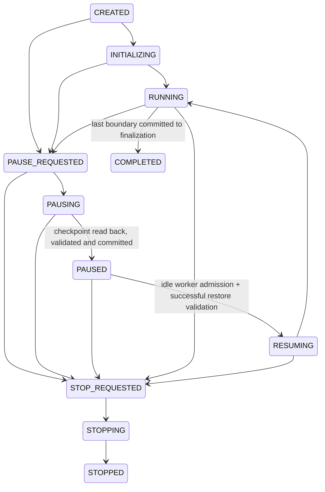

# Phase 3D: pause, resume and durable population recovery

This phase adds cooperative control to the API GA runner. It preserves the
existing operators, fitness equations and weights, selection percentages,
retry budgets and survivor selection. It does not change the notebook, add PMX,
implement authentication, add new termination rules or implement Phase 3E.

## Phase 3D.3: reconnectable live console

### Verified diagnosis

Before edits, the durable record for
`8fb9ec22-51ae-4e94-8e1c-8e74187577c2` contained checkpoint
`checkpoint-4-c1cd90a3-ee68-4a83-824e-c64f77c9226d.json.gz`, a resume timestamp
of `2026-10-11T02:42:39.058879+00:00`, latest completed generation 5, and
STOPPING with `stop_requested: true` and `execution_active: true`.
Both read-only HTTP checks against port 8000 refused connection during this
audit. The record verifies that continuation happened; it does not prove a
worker is currently alive or that the selected run is still PAUSED. No control
request or production GA was issued for this UUID.

The console failure follows a verified code path: the initial POST SSE stream
captured prints through `QueueWriter`, emitted the PAUSED banner and `done`,
then closed. Registry release detached that stream's state callback. The resumed
daemon worker had a metrics callback but no diagnostic capture. Browser recovery
only polled lifecycle/metrics. Thus resumed terminal output had no frontend
transport. The console also derived RUNNING/IDLE from `loading` rather than the
backend lifecycle. Generation 4 remains correct while generation 5 is processing;
metrics still advance only after a validated completed boundary.

### Capture and transport

`backend/services/ga_log_service.py` provides a locked buffer per existing run
UUID, with independent ordered log sequence numbers, UTC timestamps and an
ephemeral buffer epoch. Initial SSE, synchronous API execution and resumed
workers use the same adapter. GA module print calls resolve through a narrow
diagnostic facade, whose writer is confined to the executing context/thread.
Neither `sys.stdout` nor `builtins.print` is replaced. Explicit output files,
unrelated request prints and other threads keep normal print behavior. Terminal
output is still forwarded and object formatting occurs once.

The adapter binds loaded `services.ga_service` and `genetic_algorithm.*` module
namespaces at worker entry. These are the current diagnostic sources. New lazy
modules or a future Python logging-based engine would need explicit integration.
This approach avoids editing fingerprinted engine/checkpoint services: existing
checkpoint compatibility checks, format and engine fingerprint remain intact.
It consumes no GA random values and performs no fitness evaluation.

Retention is bounded to 16 buffers, 1,000 lines and 512 KiB of message text per
run, with each line limited to 4 KiB UTF-8. Partial lines are bounded too.
Executing buffers are pinned against eviction. Returned pages contain at most
200 entries and 64 KiB of serialized entry data plus a small envelope. SSE logs
retain their legacy message fields and add `log_sequence`/`log_epoch`; a full SSE
queue drops console copies immediately while the run buffer retains them within
its limits. Structured lifecycle/progress delivery is unchanged.

Read-only endpoint:

```text
GET /api/ga/runs/{run_id}/logs?after_sequence=N
X-GA-Process-ID: <current backend instance>
```

```json
{
  "run_id": "existing-run-uuid",
  "process_instance_id": "backend-instance-uuid",
  "state": "RUNNING",
  "execution_active": true,
  "log_epoch": "buffer-uuid",
  "entries": [{
    "sequence": 101,
    "timestamp": "2026-10-11T03:00:00+00:00",
    "message": "Mutation attempt ...",
    "line_truncated": false
  }],
  "latest_sequence": 104,
  "next_sequence": 101,
  "has_more": true,
  "earlier_logs_truncated": false,
  "cursor_reset": false
}
```

Use `next_sequence` as the next cursor; `latest_sequence` may include entries
not yet returned. Unknown runs and changed process ownership are explicit
404/409 errors. Reading diagnostics never restores/deserializes a population,
validates a checkpoint, calls fitness, or controls admission.

### Refresh, resume and console state

The frontend retains the authoritative run/process identity and reads the
available log tail on recovery. It orders and deduplicates by sequence within
an epoch, retaining at most 500 rendered lines. Equal text at distinct sequences
remains distinct. New SSE console copies defer to this cursor transport to avoid
duplicate delivery; legacy SSE-only servers still have their existing reader.
An epoch change replays from zero, even when the new buffer's sequence exceeds
the old cursor.

Log polling runs once per second during execution, every 250 ms while draining
a bounded backlog, and every five seconds while idle PAUSED to detect control
changes from another tab. That is a diagnostic GET in addition to any existing
metric/status polling; it never repeats start/resume/stop POSTs. A detected
external resume/stop, or restored log access after metric disconnection, uses
the existing authoritative status recovery path.
Terminal polling stops only after the worker has exited and all available pages
have drained, preserving its final banner. Reads have a 10-second deadline;
temporary failures display their endpoint/error and retry every five seconds.
Unknown ownership or an unsupported endpoint requires fresh discovery rather
than guessing another run.

The console header uses backend lifecycle (including PAUSED, RESUMING, STOPPING
and terminal states). A separate connection notice explains reconnection,
backlog, missing/truncated history or failure. Diagnostic transport failure
does not erase metrics or disable an independently verified paused checkpoint.

Logs are intentionally process-memory diagnostics, not part of durable GA
state. Backend restart/retention eviction loses old diagnostic text and the UI
explicitly reports that gap. A recovered full-population checkpoint can still
resume under its validated new process identity and collect new logs. Population,
RNG state, convergence history and run UUID remain in the existing durable
checkpoint architecture. Resume never substitutes Saved Best or generation zero.
The existing single-process execution restriction and lack of authentication
remain; deployments should restrict diagnostic access along with existing run
access. This phase introduces neither durable historical log exports nor Phase 3E.

### Verification and manual acceptance

Focused backend checks cover bounds, cursor pages, thread/run isolation, print
semantics, concurrent status/log reads, RNG/fitness-call equivalence, initial
SSE compatibility, pause/refresh/resume diagnostics before the next boundary,
registry loss and fresh-interpreter checkpoint continuation, and worker admission.
Frontend contract checks cover sequence deduplication, backlog cursors, epoch
reset, truncation and terminal polling. Browser regressions cover initial logs,
paused/running refresh, resume/restart reconnect, terminal draining, errors and
timeouts. The real browser/FastAPI integration verifies initial PAUSED logs,
same-UUID refresh, resumed diagnostics, completion and a single initial population.
All tests use bounded fixtures and private persistence destinations.

| Phase 3D.3 verification | Result |
| --- | --- |
| Existing Phase 3B/3C/3D backend regressions | 90 passed; browser case run separately |
| New diagnostic transport/backend checks | 9 distinct tests passed across verification runs |
| Real FastAPI/browser pause-refresh-resume integration | 1 passed |
| Frontend monitoring/recovery/log contracts | 31 passed |
| Headless browser suite | 34 passed (33 scenarios plus parent test) |
| TypeScript/Vite build and focused ESLint | Passed; existing bundle-size warning remains |
| Protected GA source/data/checkpoint/saved-result files | All 66 SHA-256 hashes unchanged |

Phase 3D.3 file inventory (prior phase edits remain intact):

| Area | Files changed in this task |
| --- | --- |
| Backend transport | `backend/services/ga_log_service.py` (new); `backend/routers/genetic_algorithm.py` |
| Frontend transport | `frontend/src/services/gaLogs.ts` (new); `frontend/src/services/gaService.ts`; `frontend/src/services/gaMonitoring.ts`; `frontend/src/context/GAContext.tsx` |
| Console/page | `frontend/src/components/ga/GALiveConsole.tsx`; `frontend/src/pages/admin/GenerateSchedule.tsx` |
| Tests | `backend/tests/test_ga_logs.py` (new); `frontend/tests/gaLogs.test.mjs` (new); `frontend/tests/gaMonitoring.browser.test.mjs`; `frontend/tests/gaPausedRecovery.integration.mjs`; `frontend/package.json` |
| Documentation | `docs/phase-3d-pause-resume.md` |

1. Start a small run, pause, wait for verified PAUSED, and note its UUID,
   completed generation, population, penalties and graph.
2. Refresh. Verify those metrics and available PAUSED diagnostic output recover;
   log retrieval is GET-only and Resume requires successful checkpoint validation.
3. Resume. Observe RESUMING/RUNNING in the console header, a reconnect notice if
   needed, then resumed diagnostic lines while the generation counter can remain
   at the last completed boundary. Verify the same run and graph.
4. Pause again, restart one backend worker, rediscover/verify the checkpoint and
   resume. Earlier diagnostics are reported unavailable; new lines reconnect.
5. Stop or complete. Verify the final banner and terminal lifecycle, then no
   continuing `/logs` requests. Check a copied run with truncated history or an
   unavailable log endpoint: explanatory notices must not invent metrics or
   claim that the population was lost.

Only router/diagnostic transport, console/context/contracts, targeted tests and
this documentation change in 3D.3. GA operators, scorer, workload/eligibility
rules, external/fixed assignments, faculty preferences and stored chromosomes
remain unchanged from the beginning of this task.

## Phase 3D.2: conflicting stop/pause lifecycle correction

Diagnosis used read-only requests to the actual backend on `127.0.0.1:8000`
before source edits. The generation-2/20, population-5/5 record identifies
`ee19cca4-9f6d-49a9-bb17-73125543c45a`. During initial inspection it was PAUSED;
subsequent durable-marker and HTTP reads confirmed STOPPED, with administrator
stop requested at `2026-10-11T01:54:13.571526+00:00` and stop completed at
`2026-10-11T01:55:43.756360+00:00`. Its latest generation remains 2, best-ever
penalty 20,585, average 20,852, accepted candidates 14 and three history points.
This is a genuine recorded stop, not a checkpoint failure or a resumable run.
The audit issued no stop/resume/pause/start requests to this server.

A separate UUID, `f0f86580-3035-49a4-a704-daea366d464e`, was durably PAUSED at
generation 0/20 with population 5/5, best penalty 20,835, average 21,707 and
five accepted candidates. Its stop flag is false and stop timestamp/reason are
null. The actual server's checkpoint-status endpoint returned PAUSED,
`resumable: true`, `generation_completed: 0`, `next_generation: 1`, and the
same run/process identity. Full verification took 57.13 seconds. The two run
IDs must never share monitor metrics or control intentions. No accessible
browser connection exposed the user's selected UUID or original network trace,
so which UUID was selected in the reported tab cannot be asserted. The earlier
3D.1 compatibility finding below was from that audit's environment; it does
not override this later successful validation by the running backend.

The conflicting UI was reproduced before the correction: clicking Stop while
paused verification was pending immediately set local STOP_REQUESTED, although
no server acknowledgement existed, and left the "Checking compatibility"
notice visible. POST acknowledgements had no timeout. Stale stop intent and
acknowledgement flags could also suppress authoritative snapshots. Independently,
both paused Stop and Resume held `control.lock` throughout full checkpoint
loading/validation. New API concurrency regressions failed because even cheap
GET run/status requests could not acquire that lock until validation finished.

Corrections:

- Displayed control lifecycle transitions come from backend acknowledgements,
  SSE or current status snapshots. Submission notices identify unacknowledged
  requests separately. Current snapshots override local intentions; reads begun
  before a control action are discarded. Delayed stop acknowledgements cannot
  regress STOPPING or terminal states.
- Stop immediately clears the old verification notice and disables Resume while
  the POST is outstanding. After the attempt settles, recovery rereads the same
  UUID/process and revalidates its checkpoint if genuinely PAUSED. STOP_REQUESTED,
  STOPPING and STOPPED never enable Resume. A concurrent-stop rejection of Resume
  triggers authoritative recovery rather than guessing PAUSED.
- Control requests have a 120-second connection/body deadline and specific
  acknowledgement errors. Timeout means the outcome is unknown; closing HTTP
  does not cancel the worker and no POST is automatically retried. Checkpoint
  verification retains its bounded deadline and explicit compatibility errors.
- Run/process changes clear local control flags and old metrics. Selection is
  blocked while another control request is outstanding, and only the selected
  UUID's checkpoint can enable Resume. Restart recovery queries the new process
  for a retained terminal UUID before declaring it unknown/interrupted.
- The router releases the lifecycle lock during expensive validation while
  retaining exclusive execution admission. It rechecks in-memory state, worker
  inactivity and both durable/current checkpoint references under the lock
  before claiming admission. Compatibility and hard-constraint validation remain
  mandatory; invalid or changed checkpoints start no workers.

Only Phase 3D.2 files:

| Area | Files |
| --- | --- |
| Admission/status | `backend/routers/genetic_algorithm.py` |
| Frontend recovery | `frontend/src/context/GAContext.tsx`; `frontend/src/services/gaService.ts`; `frontend/src/services/gaRecovery.ts` |
| Regressions | `backend/tests/test_ga_control_conflicts.py` (new); `frontend/tests/gaMonitoring.browser.test.mjs`; `frontend/tests/gaRecovery.test.mjs` |
| Documentation | `docs/phase-3d-pause-resume.md` |

Manual acceptance:

1. Refresh and note the exact Server run ID. A STOPPED UUID must stay terminal,
   even when another paused UUID exists or the backend has restarted. It cannot
   resume; its validated preserved result remains available.
2. Recover a PAUSED UUID. Metrics/history appear before verification finishes.
   Resume stays disabled until that exact checkpoint passes full verification.
3. While verification is pending, request Stop. The confirmed lifecycle remains
   visible with a separate acknowledgement notice; the old compatibility message
   disappears. Resume and duplicate Stop submissions are disabled.
4. Query GET status/run while paused Stop/Resume validates. Reads remain available;
   admission still rejects duplicate workers. After acknowledged stop, observe
   STOP_REQUESTED/STOPPING/STOPPED and no Resume control.
5. Reject a stop using an isolated incompatible checkpoint. Show the specific
   error, recover backend PAUSED with original UUID/history, and require a new
   compatibility check before Resume. Do not alter institutional inputs merely
   to test this case.
6. Refresh during pending pause, stop, resume and after acknowledgement. Confirm
   no control POST or fresh population construction occurs during refresh.
7. Select another idle paused run. Monitor UUID, generation, history and checkpoint
   verification must all refer to that same selection. Resume continues its full
   saved population/RNG state at the next generation, never from Saved Best.

Remaining limits: full verification is CPU-intensive and can legitimately take
tens of seconds; no compatibility checks were bypassed or weakened. A lost
control connection cannot reveal the POST's outcome without further status reads.
The application still requires one execution process. In Phase 3D.2 a verified
idle paused view did not continuously poll for another administrator's changes;
Phase 3D.3 adds a slow diagnostic/lifecycle check. Every control POST is still
validated again by the server, and a rejected Resume reconciles lifecycle.
Load these router changes in the running backend (restart/reload with one worker
if it does not reload automatically), retaining the same compatible engine/runtime
and private checkpoint storage. No institutional run was restarted by this fix.

Phase 3D.2 verification results:

| Check | Result |
| --- | --- |
| Combined Phase 3B/3C/3D monitoring, safe-stop, recovery, checkpoint and conflict API suite | 88 passed, real browser case deselected; 877.75 seconds |
| Focused final conflict/admission suite | 7 passed; includes two race cases added after combined-suite collection |
| Distinct backend control/API checks | 90 passed (five cases overlap between the two runs) |
| Real browser + isolated FastAPI start/pause/refresh/resume | 1 passed after the final frontend correction; 64.84 seconds |
| Monitoring/recovery/control-timeout frontend contracts | 23 passed |
| Headless browser monitoring, refresh and stop/pause conflict checks | 25 passed |
| TypeScript/Vite build and focused production-module ESLint | Passed; existing large-bundle warning remains |
| Diff whitespace check | Passed |
| Preservation hashes | All 64 captured GA-source/service, input, saved-result and checkpoint/marker files unchanged; no new files in those artifact sets |

The status-lock concurrency cases and the contradictory-message browser case
failed before the fix and passed afterward. Existing exact continuation tests
still compare population outcomes, schedules/history, RNG state and fitness-call
counts. All evolution in verification used bounded isolated fixtures, with
temporary checkpoint/result destinations; no production GA was started. The
running backend reloaded automatically during source editing and subsequent
read-only discovery still reported the same idle PAUSED UUID under its new process
identity. Its original checkpoint and marker bytes were preserved. An existing
development frontend listener was left running; the real browser used a private
profile and routed its API requests to the isolated ephemeral test backend.
Backend dependency deprecation warnings remain. No commits, pushes or Phase 3E
changes were made.

## Phase 3D.1: paused-run refresh recovery correction

Diagnosis preceded source changes. The retained institutional record was
`ee19cca4-9f6d-49a9-bb17-73125543c45a`: durably PAUSED, worker inactive,
generation 2 of 20, population 5, three history points, best-ever penalty
20,585, average 20,852, accepted candidates 14 and active elapsed time
159,079 ms. Its referenced compressed checkpoint existed and its canonical
payload checksum matched. The marker and writer ordering confirm that the
pause commit and worker release happened. This is a different configuration
from the reported 10/2 experiment; that exact run was not available to inspect.
There was no listener at the frontend's configured `127.0.0.1:8000` during
diagnosis, so the original browser's HTTP timing cannot be verified retroactively.

Full restoration of the retained checkpoint was rejected **before this fix**:
its engine fingerprint was `4a25dec853c14a14cf0928e72636f79689ef31fb35afbe465584c24d8ffd3777`,
while the current environment/code fingerprint was
`b69ab58649e7e788ccd3ca4681c59c890a9de0ca09526da8d1a9713ed6ea4c23`.
Scheduling-input fingerprints matched. This proves a compatibility rejection,
not checkpoint loss. The precise cause of the earlier engine/runtime difference
is not recorded. This patch does not bypass that guard or rewrite the artifact.

The verified recovery defect was a request dependency: frontend discovery used
`Promise.all(status, latest saved result)` and hydrated nothing until both
finished. In addition, `/status` restored and hard-validated **every** paused
population before returning metadata. There were no request deadlines. A
browser regression with an acknowledged paused run and a nonresponding saved
result reproduced the indefinite "Checking the backend for an active run"
screen, empty metrics and missing Resume control before the correction.
The checkpoint remained available throughout the reproduction.

Correction:

* `/status` discovers durable PAUSED metadata/history without deserializing
  populations. Its paused entries have `accepting_resume: false` until the
  selected run is verified separately. It does not start or resume a worker.
* Saved-result loading runs independently. Authoritative run identity,
  configuration, generation, population counts, penalties, accepted counts,
  elapsed time and convergence history hydrate immediately. Incomplete paused
  metrics produce an explicit recovery error; they are not replaced with zeros.
* Read-only status/discovery requests have a 10-second deadline; checkpoint
  verification and result retrieval have a 120-second deadline, including JSON
  body reading. A deadline aborts only the read, never the GA worker. Recovery
  settles into a lifecycle state or actionable error. Refresh retries discovery.
* PAUSED metadata displays while full checkpoint verification is pending.
  Resume remains disabled until the backend confirms PAUSED, idle and valid
  under the observed process identity. Verification failures retain metrics and
  history and explain why resume is disabled. An incompatible retained run
  therefore remains inspectable without becoming resumable.
* Checkpoint-status requests accept `X-GA-Process-ID` and return process identity
  and current lifecycle state. After slow validation, the endpoint rechecks
  lifecycle, worker activity and checkpoint reference to avoid stale permission.
  Frontend control revisions prevent older polling/verification responses from
  undoing a subsequent control request.
* Resume still uses the existing full restore/admission path: same run UUID,
  ordered population, next generation and random state. It revalidates before
  worker admission. No saved-best substitution or generation-zero restart was
  added. PAUSED is still committed only after checkpoint write/read validation.

The only production backend change in 3D.1 is the router. GA services,
checkpoint/control writers, evaluator and genetic operators are unchanged;
the current engine fingerprint remains unchanged by this patch. Faculty
preferences, saved results and the retained institutional checkpoint/marker
are preserved byte for byte. Phase 3E is not started.

### Manual acceptance for 3D.1

1. Run the updated backend on `127.0.0.1:8000` with one worker and use the
   updated frontend. Record `/api/ga/status` process identity. Existing
   incompatible checkpoints should display their history and rejection reason.
2. Start population 10, limit 2. Request Pause Generation while a generation
   is active. Observe PAUSE_REQUESTED, then PAUSING; neither means resumable.
3. Wait for PAUSED and `execution_active: false`. Check the checkpoint-status
   response confirms `resumable: true`. Record run UUID, completed generation,
   actual/requested population, best/average penalties, accepted count, elapsed
   time and graph points. A very fast run may complete before pause is accepted;
   use a larger generation limit for that separate boundary test if needed.
4. Refresh. Verify the same recorded identity/metrics/history. They must appear
   before checkpoint verification finishes. Resume becomes enabled after
   verification, with no fresh-run POST issued by refresh.
5. Select Resume Generation. Verify the same UUID and the next generation;
   history extends rather than resetting. Refresh while RESUMING and verify
   continued monitoring without another resume/start POST.
6. Repeat refresh while pause is pending. Preserve pending/saving states until
   the checkpoint commit succeeds; never enable resume early.
7. Restart the backend while durably paused, retaining identical code/runtime
   and scheduling inputs. Refresh adopts the new process identity and verifies
   the same checkpoint. Restart without a committed checkpoint instead produces
   INTERRUPTED and disabled resume.
8. Test an unavailable backend, a slow discovery request and a copied invalid
   checkpoint. Recovery must settle with an endpoint/retry explanation, retain
   any hydrated paused metrics and never create a replacement population.

Remaining limitations: one backend worker/process; no cross-process execution
lease, automatic continuation or checkpoint migration. Full validation is still
expensive and a large checkpoint can exceed its deadline; refresh retries the
read, and an aborted read does not forcibly terminate server-side validation.
Engine/schema/runtime and input compatibility remain mandatory. Historical
console logs are not persisted. An old best schedule cannot recover a lost
population. The currently retained incompatible checkpoint requires its
compatible code/runtime to resume; it is not repaired by weakening validation.

### Files changed only for 3D.1

| Area | Files |
| --- | --- |
| Lightweight discovery/process-bound verification | `backend/routers/genetic_algorithm.py` |
| Hydration, deadlines, contracts and errors | `frontend/src/context/GAContext.tsx`; `frontend/src/services/gaService.ts`; `frontend/src/services/gaRecovery.ts` |
| Paused status wording | `frontend/src/components/ga/LiveGAMonitor.tsx` |
| Backend API and real browser/HTTP integration | `backend/tests/test_ga_paused_recovery.py` (new); `frontend/tests/gaPausedRecovery.integration.mjs` (new) |
| Recovery contracts/browser races | `frontend/tests/gaRecovery.test.mjs`; `frontend/tests/gaMonitoring.browser.test.mjs` |
| Findings and manual procedure | `docs/phase-3d-pause-resume.md` |

The earlier Phase 3D working-tree changes remain in place. The three page
consumers were inspected and need no additional 3D.1 edits: all consume the
shared context/monitor, including actionable recovery notices in GA Analysis.

### 3D.1 verification

The real browser test is launched through the isolated pytest live-server
fixture. It uses population request 10 and limit 2, bounded real-model inputs,
temporary checkpoint/latest/best paths, an ephemeral backend port and the
existing allowed frontend origin `localhost:5173`. The regression deliberately
stalls saved-result loading after refresh and compares every displayed metric
with the authoritative paused backend snapshot. It verifies no control POST
during refresh, one initial-population construction, the same run UUID after
resume and history through generation 2. It runs separately from the mocked
browser suite; an existing listener on 5173 must not be displaced.

Commands (Windows):

```powershell
npm.cmd --prefix frontend run test:ga
npm.cmd --prefix frontend run test:ga:browser
.venv/Scripts/python.exe -m pytest backend/tests/test_ga_paused_recovery.py -k real_browser -q
```

For the real browser test, Windows test-directory ownership may require a new
private `--basetemp` path instead of an existing pytest directory. The browser
uses an owned temporary profile, disables extensions/sync/background networking
and cleans up its own profile and processes. No full production GA is run.

| Check | Result |
| --- | --- |
| Combined Phase 3B/3C/3D control/checkpoint and new recovery API suite | 83 passed (70 existing + 13 new); real browser case run separately |
| Existing eligibility, hard constraints, preassignment, tournament, API crossover, metadata and preference validation | 153 passed |
| Real browser + isolated FastAPI pause/refresh/resume integration | 1 passed; generation 2 reached under the same UUID, initial population constructed once |
| Distinct targeted backend checks across these runs | 237 passed (223 existing + 14 new) |
| Monitoring/recovery frontend contracts | 21 passed |
| Headless browser monitoring/recovery suite | 20 passed |
| Frontend TypeScript/Vite build | Passed; existing bundle-size warning remains |
| Focused ESLint for changed production frontend modules | Passed; existing GAContext mixed-export rule exemption retained |
| Diff whitespace and engine/data/artifact preservation | Passed |

The combined control/checkpoint suite completed in 943.28 seconds; the real
browser/HTTP test completed separately in 86.58 seconds. Backend package
deprecation warnings remain. The request-coupling browser regression failed
before the fix and passed afterward. Final engine fingerprint matched the
pre-fix current fingerprint. SHA-256 checks confirmed unchanged preferences,
latest/best saved results and both retained institutional checkpoint/marker
files. No institutional run was started or resumed during these checks.

## Lifecycle and safe boundaries



Failures can enter FAILED from any nonterminal state. INITIALIZING and CREATED
also accept stop. PAUSED, STOPPED, COMPLETED and FAILED remain distinct. A
recovered nonterminal record other than PAUSED becomes INTERRUPTED. It has no
worker and cannot resume. Terminal runs do not accept new control requests.

Pause requests latch a flag; the HTTP acknowledgement means **requested**, not
that a checkpoint exists. Population construction, crossover retries and
mutation finish normally. The runner validates every ordered survivor, records
the completed generation and its metrics, then checks control state. An early
pause waits for a complete validated generation-zero population. It never
fabricates an empty checkpoint. Stop before initialization retains its existing
no-result semantics.

At a boundary, pending stop wins over pause. Stop arriving during checkpoint
writing also wins: the checkpoint file can remain for inspection, but PAUSED is
not committed. At the last generation, the control lock chooses pending pause
or finalization. After finalization begins, a later pause/stop returns a conflict.
Resuming a checkpoint at the generation limit finalizes the same best candidate
without creating another generation.

A paused worker returns a dedicated `PausedRun` sentinel. It does not run final
fitness analysis, update saved best, publish a schedule or overwrite the latest
completed result. The worker releases admission before its stream's `done`
event. Resume starts a new tracked worker for the **same run UUID**.

## API and monitoring contract

All paths use `/api/ga`. Existing `control_version: "3c.1"` remains compatible;
`GET /status` additionally advertises `pause_resume_version: "3d.1"`.

| Endpoint | Behavior |
| --- | --- |
| `POST /runs/{run_id}/pause` | Latches PAUSE_REQUESTED. Duplicate pending/paused requests acknowledge `already_requested: true`. |
| `POST /runs/{run_id}/resume` | Validates the full durable checkpoint, claims exclusive execution admission, commits RESUMING and launches continuation. |
| `GET /runs/{run_id}` | Authoritative lifecycle, identity, capabilities, timestamps, active elapsed milliseconds, latest progress and full retained progress history. |
| `GET /runs/{run_id}/checkpoint-status` | Process identity/current lifecycle, checkpoint reference, generation, verified resumability, next generation and a validation error if unavailable/incompatible. Does not start a worker. |
| `POST /runs/{run_id}/stop` | Existing cooperative stop; an idle PAUSED run restores and finalizes its valid boundary without advancing a generation. |
| `GET /status` | Current process identity, active run and lightweight discovered paused metadata/history. Verify the selected checkpoint separately before enabling resume. |

Control responses include `run_id`, `process_instance_id`, `state`, `accepted`
and `already_requested`. Send the observed `X-GA-Process-ID` with pause, resume,
stop and state requests. After a restart, rediscover the backend and adopt its
new process identity before acting on a durable paused run.

* Unknown run: 404, `GA_UNKNOWN_RUN`.
* Wrong process: 409, `GA_PROCESS_CHANGED`.
* Busy admission: 409, `GA_EXECUTION_BUSY`.
* Illegal pause/resume transition: 409, `GA_PAUSE_CONFLICT` / `GA_RESUME_CONFLICT`.
* Changed inputs: 409, `GA_CHECKPOINT_INPUT_CHANGED`.
* Incompatible code/runtime/schema: 409, `GA_CHECKPOINT_INCOMPATIBLE`.
* Missing, corrupt or invalid checkpoint: 422, `GA_CHECKPOINT_INVALID`.
* Terminal pause/resume: 200 with `accepted: false`; does not launch a worker.
* Repeated resume while its resumed worker is RESUMING/RUNNING: idempotent 200.
  Concurrent admission attempts may instead receive a busy/conflict response;
  only one worker can claim execution.

The SSE envelope stays at schema version 1. Lifecycle events carry the added
states and capabilities. A paused stream ends with
`done { status: "PAUSED", has_result: false }` and no `result` event. Resume and
refresh use bounded read-only state polling, retaining the original convergence
history. No WebSocket or log parsing is required.

## Checkpoint schema and storage

Private, git-ignored storage:

```text
backend/run_checkpoints/<run UUID>/
    status.json
    checkpoint-<completed generation>-<checkpoint UUID>.json.gz
```

The compressed file contains a JSON envelope with `payload` and its SHA-256
checksum. Payload schema version 1 / engine version `ga-continuation-v1` stores:

* Run identity; schema, engine, input and configuration fingerprints.
* Completed/next generation; requested and actual population sizes.
* The **entire ordered survivor population**, best-ever candidate and fitness.
* Evolution history, telemetry history, accepted-candidate count, baseline count,
  previous best and generations without improvement.
* Python `random.getstate()` including the Gaussian cache.
* Effective API parameters, legacy preference DataFrame values/columns/index/
  dtypes, dashboard preferences, GA settings and normal scoring faculty profiles.
* Working and publication templates, eligibility, release loads, fixed section
  calendars, external preassignment declarations and room locks.
* Active elapsed time, lifecycle snapshot and validation metadata.
* Original CSV/JSON input text for private diagnostic provenance.

Schedule rows alone are insufficient. The graph codec also retains calendar
availability, cached loads, shared references, list/dictionary order, tuples
and cycles among model objects. The loader allocates only eight explicitly
allowlisted passive model types; it invokes no constructors, dynamic imports,
pickle or executable expressions from the file.

Writes use a same-directory temporary file, flush, file fsync, atomic replace
and POSIX directory fsync where available. Windows does not offer portable
directory fsync through this implementation. Each checkpoint uses a new filename,
so an incomplete attempt cannot overwrite the previous valid artifact. The
runner reloads and validates the saved file before atomically committing its
PAUSED lifecycle marker, then emits the PAUSED acknowledgement. A checkpoint or
marker write failure fails the worker; it never acknowledges PAUSED. Previous
checkpoint bytes remain intact. Failed/interrupted records do not automatically
roll back to an older checkpoint.

Loading verifies checksum, versions, identity, code/runtime fingerprint and
current input fingerprint. Every survivor and best-ever passes the publication
gate against both current authoritative templates and stored templates. This
includes eligibility, resource conflicts, the 40-unit hard maximum, fixed
schedules, external Palad assignments, ICT3A locks and supported continuous
component durations. Population/generation counters, history and RNG state are
also checked. Invalid data has no best-seed fallback.

## Exact continuation and frozen inputs

The scorer's existing settings, dashboard preference and normal faculty loaders
now consult a context-local snapshot during API evolution and final analysis.
The legacy DataFrame and full model graph are retained as well. The fitness
formula remains unchanged: lower penalty is better; teaching target is
`max(0, 24 - admin - research - extension)`; underload is soft and 40 is hard.

The input fingerprint still guards every generation and publication. Resume
strictly rejects any changed CSV/JSON scheduling input, including preferences
and weights, even though frozen values are stored. This conservative rule
prevents continuing against altered institutional data. Files loaded into the
existing module-level scheduling templates should be changed only with the
normal backend reload/restart workflow; this phase does not implement dynamic
dataset reloading.

Input fingerprints are checked before and after snapshot capture and again at
monitor construction. An edit during capture or between capture and monitoring
is rejected before population construction, so a mixed startup snapshot cannot
be labeled with a newer input fingerprint.

Restore finishes all validation and context setup before `random.setstate`.
That restoration happens immediately before continuation of the original loop.
It does not initialize another population, rescore for telemetry, rerun completed
generations, add random draws or reconstruct calendars from schedule-only rows.
The actual current GA uses Python's global RNG; no NumPy RNG participates in
evolution. A future RNG requires its own schema/compatibility update.

Paused wall time is excluded from active elapsed accounting. Durations and UTC
timestamps naturally differ from an uninterrupted run; they are not evolution
inputs and are not included in deterministic outcome comparisons.

## Restart behavior and limitations

Discovery reads durable records without executing the GA. Valid PAUSED records
are adopted under the new process identity. Uncheckpointed CREATED,
INITIALIZING, RUNNING, RESUMING, PAUSE_REQUESTED, PAUSING or STOPPING records
become INTERRUPTED. A checkpoint file without a committed PAUSED marker is not
resumable. Completed/stopped/failed records remain terminal. Existing result
retrieval and validation behavior is preserved.

This is a **single backend process** design. Use one Uvicorn worker; do not run
several servers against the same checkpoint directory. The process admission
lock protects all API GA paths and resume attempts. There is no distributed
lease/file lock or protection against another independent process editing files
or consuming the global RNG. Development auto-reload interrupts active workers.
There is no automatic resume on boot.

Checkpoint JSON is bounded at 512 MiB decompressed and two million graph nodes.
Full calendar graphs, including current synthetic student calendars, can be
large; pause writes/revalidation can consume substantial time and memory. No
production-sized benchmark is claimed. Size/write failures are explicit rather
than a reduced-state checkpoint. Retention/pruning, stronger storage encryption,
cross-version migration and checkpoint download are not implemented. Keep these
private files restricted to the application administrator: they contain faculty
preferences and source data. A checksum detects damage; it is not authentication
against someone with write access. Authentication and multi-user authorization
remain future work, not implied by the administrator-facing buttons.

## Frontend

Generate Schedule, Dashboard and Fitness Analysis share Pause Generation,
Resume Generation and existing Stop Generation controls. The UI distinguishes
requested pause, checkpoint saving, durable pause, state restoration and stop.
It enables resume only after worker exit and checkpoint validation, freezes its
elapsed display during pause, and preserves history and current/best-ever
penalties. Reload discovers the same run UUID under the current backend identity.
Several discovered paused runs can be selected. An invalid checkpoint displays
the error without sending a new `/stream` start or resetting the graph.

## Verification and acceptance

Tests use bounded real scheduling-model fixtures and temporary checkpoint/result
destinations. They never run a full production GA or save faculty preferences.

* Deterministic equivalence at generation 0, mid-run and the last generation:
  final schedule, best fitness, breakdown, faculty analysis, evolution history,
  global RNG state and original fitness-call count must equal uninterrupted
  execution. Generation events must occur once in order.
* Fresh Python interpreter continuation validates disk reconstruction without
  original object identities, prohibits initialization and compares final RNG,
  outcome/history and next-generation event against uninterrupted execution.
* Real HTTP integration sends pause through a separate connection while an SSE
  run is held in mutation; verifies responsiveness, no paused result publication,
  admission cleanup and continuation without initialization.
* Retry-boundary, early-pause, stop-priority, completion-race, duplicate/concurrent
  control, disk-failure, corruption, incompatibility, invalid-population and
  interrupted-restart cases must fail or acknowledge truthfully.
* Browser tests preserve graph values through pause, refresh/backend identity
  replacement and resume, and reject incompatible resume without another start.
* Existing Phase 3B/3C/3C.1, eligibility, fixed/preassigned, preference metadata
  and frontend preference regressions remain required.

The deterministic fixtures bound crossover/mutation with controlled random
choices while retaining the original orchestration, real scorer and hard
validators. Separate existing operator tests cover the actual implementations.
This is equivalence evidence for the checkpoint/control integration, not an
exhaustive proof or a production-scale performance claim.

An AST comparison against the accepted baseline also verified that the only
added statement inside the generation loop is the boundary pause check. The
population, tournament, crossover and mutation operator files are unchanged;
the scorer diff contains only input-snapshot loader hooks.

Final automated results:

| Checks | Result |
| --- | --- |
| Existing targeted backend regressions | 199 passed (153 domain/API tests + 46 monitoring/stop/recovery tests) |
| New Phase 3D backend tests | 24 passed |
| Combined backend coverage | 223 distinct targeted tests passed across verification runs |
| GA monitoring/recovery contract tests | 18 passed |
| GA monitoring browser tests | 14 passed |
| Faculty preference model/browser regressions | 19 + 22 passed |
| Frontend TypeScript/Vite build | Passed; existing bundle-size warning remains |
| Focused frontend ESLint and diff whitespace checks | Passed; existing mixed-export rule exemption used for GAContext |

The final control suite completed 69 cases (23 new + 46 existing); the late
startup-persistence failure test and the three admission cases then passed in
a focused four-case run after startup was moved inside the router cleanup guard.
Startup failure now releases admission and records FAILED without running GA
initialization. The 153 domain/API regressions ran separately. No full production
GA was executed. Preference JSON and both production latest/best saved-result
SHA-256 hashes matched their pre-task values.

Manual acceptance:

1. Start a small fresh run and request pause during initialization. It remains
   pending until generation zero is valid, then shows checkpoint saving/PAUSED.
2. Check that the saved latest/best artifacts are unchanged while paused.
3. Refresh; verify the same run, graph, generation and penalties. Resume and
   observe the next generation without a graph reset.
4. Pause again, restart the backend with one worker, rediscover and resume the
   same UUID under its new process identity.
5. Request stop while pause is pending and while idle PAUSED. Verify STOPPED
   with a validated preserved result and no extra generation after the boundary.
6. Change an input while paused or damage a copied checkpoint. Resume must
   explain rejection, preserve history and never create a fresh population.
7. Restart during RUNNING without a committed pause. Verify INTERRUPTED and
   disabled resume. Restore inputs before any subsequent normal run.

## Files and Phase 3E boundary

Backend: `ga_checkpoint_service.py`, `ga_control_service.py`, `ga_service.py`,
`ga_progress_service.py`, GA router, `FrozenInputs.py` and scorer loader hooks.
Frontend: GA context, monitoring/recovery/service contracts, LiveGAMonitor and
its three administrator page consumers. Tests: isolated checkpoint fixture,
pause/resume integration/equivalence tests and monitoring/browser contracts.

Complete change inventory:

| Area | Files |
| --- | --- |
| Storage | `.gitignore`; `backend/services/ga_checkpoint_service.py` (new) |
| Control/API | `backend/services/ga_control_service.py`; `backend/routers/genetic_algorithm.py` |
| Evolution/telemetry | `backend/services/ga_service.py`; `backend/services/ga_progress_service.py` |
| Frozen evaluation | `backend/genetic_algorithm/utils/FrozenInputs.py` (new); `backend/genetic_algorithm/operators/FitnessFunction.py` (loader hooks only) |
| UI/context | `frontend/src/context/GAContext.tsx`; `frontend/src/components/ga/LiveGAMonitor.tsx` |
| UI contracts | `frontend/src/services/gaMonitoring.ts`; `frontend/src/services/gaRecovery.ts`; `frontend/src/services/gaService.ts` |
| Page consumers | `frontend/src/pages/admin/GenerateSchedule.tsx`; `Dashboard.tsx`; `FitnessAnalysis.tsx` |
| Backend tests | `backend/tests/conftest.py` (new isolated storage); `backend/tests/test_ga_pause_resume.py` (new) |
| Frontend tests | `frontend/tests/gaMonitoring.test.mjs`; `frontend/tests/gaMonitoring.browser.test.mjs` |
| Documentation | `docs/phase-3d-pause-resume.md` (new) |

Phase 3E can build separate immutable validated schedule-candidate snapshots
and exports on the completed-generation boundary. These private continuation
checkpoints should not become public schedule downloads or historical candidate
identities. Phase 3E still needs retention, per-generation candidate persistence,
export schemas and independent export validation. None is implemented here.
